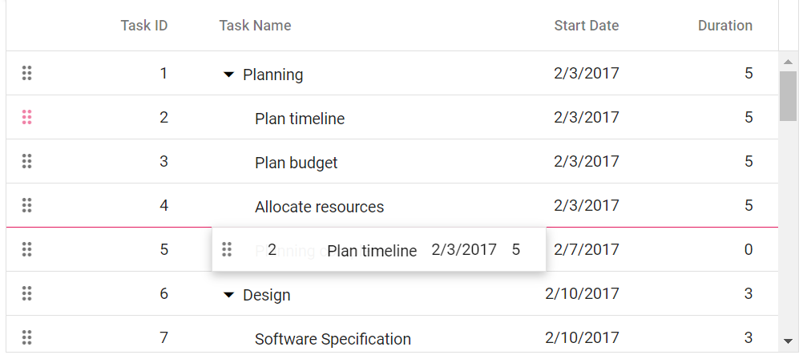
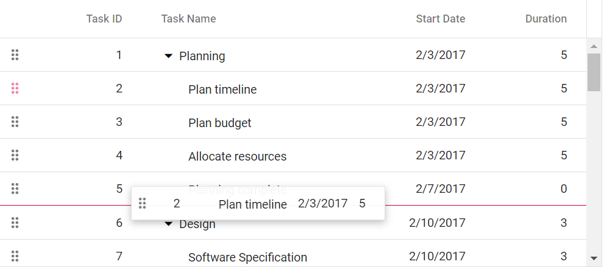
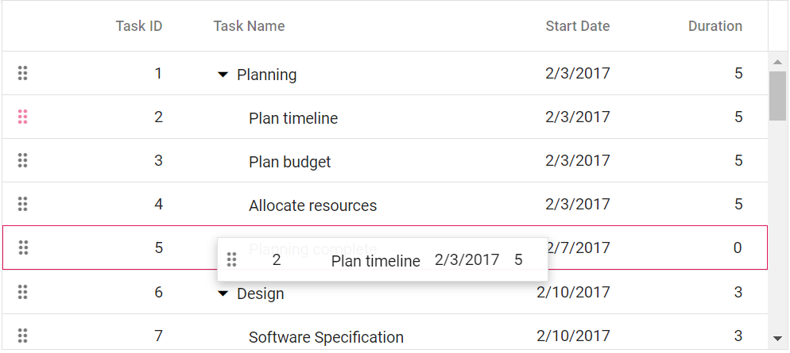

# Row drag and drop between multiple TreeGrids in Angular TreeGrid

The Syncfusion&reg; Angular TreeGrid supports moving rows between three or more TreeGrid instances. Each TreeGrid declares the destination it accepts rows into through the [`targetID`](https://ej2.syncfusion.com/angular/documentation/api/treegrid/rowDropSettings#targetid) property of the [`rowDropSettings`](https://ej2.syncfusion.com/angular/documentation/api/treegrid/rowDropSettings) object, so a row can be dragged from one TreeGrid into another without copying and pasting the data manually.

To use the row drag and drop feature in the TreeGrid component, inject the **RowDDService** in the provider section of the **AppModule**. The **RowDDService** handles the row drag and drop functionality in the TreeGrid component. Once the **RowDDService** is injected, the [`allowRowDragAndDrop`](https://ej2.syncfusion.com/angular/documentation/api/treegrid#allowrowdraganddrop) and [`targetID`](https://ej2.syncfusion.com/angular/documentation/api/treegrid/rowDropSettings#targetid) properties can be used to enable and configure the feature.

## Configure the target TreeGrid for each instance

The [`targetID`](https://ej2.syncfusion.com/angular/documentation/api/treegrid/rowDropSettings#targetid) property accepts the ID of a single destination TreeGrid. Because each TreeGrid owns its own [`rowDropSettings`](https://ej2.syncfusion.com/angular/documentation/api/treegrid/rowDropSettings) object, a row can only be dropped into the TreeGrid that the dragged TreeGrid points to.

To connect three or more TreeGrids, assign the ID of the destination TreeGrid to the [`targetID`](https://ej2.syncfusion.com/angular/documentation/api/treegrid/rowDropSettings#targetid) property of every TreeGrid that should accept rows. The following table shows the configuration used in the sample that follows.

| TreeGrid ID | targetID value | Rows can be dropped into |
|---|---|---|
| `TreeGrid1` | `TreeGrid2` | `TreeGrid2` |
| `TreeGrid2` | `TreeGrid3` | `TreeGrid3` |
| `TreeGrid3` | `TreeGrid1` | `TreeGrid1` |

This creates a cycle, so a row can be moved from `TreeGrid1` to `TreeGrid2`, from `TreeGrid2` to `TreeGrid3`, and from `TreeGrid3` back to `TreeGrid1`.

To let several TreeGrids feed rows into a single destination, point each of them at the same TreeGrid ID. For example, setting the [`targetID`](https://ej2.syncfusion.com/angular/documentation/api/treegrid/rowDropSettings#targetid) property of `TreeGrid1` and `TreeGrid2` to `TreeGrid3` allows both of them to drop rows into `TreeGrid3`.

> * The [`targetID`](https://ej2.syncfusion.com/angular/documentation/api/treegrid/rowDropSettings#targetid) property must contain the ID of the destination TreeGrid, and the ID must be unique across the page.
> * The order in which the TreeGrids are rendered does not affect the drag and drop behavior. The destination TreeGrid can be created before or after the source TreeGrid.

## Enable row drag and drop between three TreeGrids

The following example enables the [`allowRowDragAndDrop`](https://ej2.syncfusion.com/angular/documentation/api/treegrid#allowrowdraganddrop) property on three TreeGrids and configures a circular drop target for each of them using the [`targetID`](https://ej2.syncfusion.com/angular/documentation/api/treegrid/rowDropSettings#targetid) property.












> * The [`isPrimaryKey`](https://ej2.syncfusion.com/angular/documentation/api/treegrid/column#isprimarykey) property is necessary to perform the row drag and drop operation.
> * The selection feature must be enabled to drag and drop rows between TreeGrids. For multiple row selection, set the [`type`](https://ej2.syncfusion.com/angular/documentation/api/treegrid/selectionSettings#type) property to **Multiple**.

## Drop positions

When a row is dragged over a destination TreeGrid, the drop indicator shows the position where the row will be inserted.

1. **Above** – The row is inserted as a sibling above the target row.
2. **Below** – The row is inserted as a sibling below the target row.
3. **Child** – The row is inserted as a child of the target row.

These positions apply equally when the destination is another TreeGrid. Dropping a row in the **Child** position of a row in the destination TreeGrid makes it a child of that record, and the parent record of the dropped row is updated accordingly.

## Move multiple rows between TreeGrids

Multiple rows can be moved in a single drag operation. Select the rows in the source TreeGrid by holding the **Ctrl** key, and then drag any of the selected rows into the destination TreeGrid. All the selected rows are transferred together, and the dropped records are available in the [`rowDrop`](https://ej2.syncfusion.com/angular/documentation/api/treegrid#rowdrop) event through the `args.data` property.

To move more than one row at a time, the [`selectionSettings.type`](https://ej2.syncfusion.com/angular/documentation/api/treegrid/selectionSettings#type) property must be set to **Multiple** on the source TreeGrid.

## Handle the rowDrop event

The [`rowDrop`](https://ej2.syncfusion.com/angular/documentation/api/treegrid#rowdrop) event is triggered when a row is dropped on the destination TreeGrid. The event arguments provide the following information.

| Argument | Type | Description |
|---|---|---|
| `data` | `Object[]` | The dragged record or the array of dragged records when multiple rows are selected. |
| `fromIndex` | `number` | The index of the dragged row in the source TreeGrid. |
| `dropIndex` | `number` | The index where the row is dropped in the destination TreeGrid. |
| `dropPosition` | `string` | The position of the drop relative to the target row. It is `topSegment` for **Above**, `bottomSegment` for **Below**, and `middleSegment` for **Child**. |
| `target` | `Element` | The target element on which the row is dropped. |
| `cancel` | `boolean` | Setting it to `true` prevents the default drop behavior. |

The event is triggered on the source TreeGrid, so the source and the destination can be identified from the `target` element when several TreeGrids are on the page.




import { Component, ViewChild, OnInit } from '@angular/core';
import { TreeGridComponent, RowDDService } from '@syncfusion/ej2-angular-treegrid';
import { RowDragEventArgs } from '@syncfusion/ej2-angular-grids';
import { sampleData } from './datasource';

@Component({
    selector: 'app-container',
    template: `

        

            <ejs-treegrid id='TreeGrid1' [dataSource]='data' [allowRowDragAndDrop]='true' height='250' [treeColumnIndex]='1'
                [rowDropSettings]='firstTreeDrop' [selectionSettings]='selectionSettings' childMapping='subtasks'
                (rowDrop)='rowDrop($event)'>
                <e-columns>
                    <e-column field='taskID' headerText='Task ID' [isPrimaryKey]='true' textAlign='Right' width=90></e-column>
                    <e-column field='taskName' headerText='Task Name' textAlign='Left' width=180></e-column>
                    <e-column field='duration' headerText='Duration' textAlign='Right' width=80></e-column>
                </e-columns>
            </ejs-treegrid>
        

        

            <ejs-treegrid id='TreeGrid2' height='250' [allowRowDragAndDrop]='true' [treeColumnIndex]='1'
                [rowDropSettings]='secondTreeDrop' [selectionSettings]='selectionSettings' childMapping='subtasks'
                (rowDrop)='rowDrop($event)'>
                <e-columns>
                    <e-column field='taskID' headerText='Task ID' [isPrimaryKey]='true' textAlign='Right' width=90></e-column>
                    <e-column field='taskName' headerText='Task Name' textAlign='Left' width=180></e-column>
                    <e-column field='duration' headerText='Duration' textAlign='Right' width=80></e-column>
                </e-columns>
            </ejs-treegrid>
        

        

            <ejs-treegrid id='TreeGrid3' height='250' [allowRowDragAndDrop]='true' [treeColumnIndex]='1'
                [rowDropSettings]='thirdTreeDrop' [selectionSettings]='selectionSettings' childMapping='subtasks'
                (rowDrop)='rowDrop($event)'>
                <e-columns>
                    <e-column field='taskID' headerText='Task ID' [isPrimaryKey]='true' textAlign='Right' width=90></e-column>
                    <e-column field='taskName' headerText='Task Name' textAlign='Left' width=180></e-column>
                    <e-column field='duration' headerText='Duration' textAlign='Right' width=80></e-column>
                </e-columns>
            </ejs-treegrid>
        

    
`,
    providers: [RowDDService]
})
export class AppComponent implements OnInit {
    @ViewChild('treeGrid1') public treeGrid1?: TreeGridComponent;
    public data?: Object[];
    public firstTreeDrop?: Object;
    public secondTreeDrop?: Object;
    public thirdTreeDrop?: Object;
    public selectionSettings?: Object;

    ngOnInit(): void {
        this.data = sampleData;
        this.selectionSettings = { type: 'Multiple' };
        this.firstTreeDrop = { targetID: 'TreeGrid2' };
        this.secondTreeDrop = { targetID: 'TreeGrid3' };
        this.thirdTreeDrop = { targetID: 'TreeGrid1' };
    }

    public rowDrop(args: RowDragEventArgs): void {
        const targetGrid = (args.target as HTMLElement).closest('.e-treegrid');
        const destinationID = targetGrid ? targetGrid.id : '';
        const position = args.dropPosition;
        console.log(`Row dropped into ${destinationID} at position ${position}.`);
    }
}







## Supported combinations

### Works with:

- The [`allowRowDragAndDrop`](https://ej2.syncfusion.com/angular/documentation/api/treegrid#allowrowdraganddrop) property, which must be enabled on the source and the destination TreeGrid.
- The [`selectionSettings.type`](https://ej2.syncfusion.com/angular/documentation/api/treegrid/selectionSettings#type) property set to **Multiple**, which enables moving several rows in one drag operation.
- The [`isPrimaryKey`](https://ej2.syncfusion.com/angular/documentation/api/treegrid/column#isprimarykey) property, which is required for the drop to be applied.
- The [`rowDrop`](https://ej2.syncfusion.com/angular/documentation/api/treegrid#rowdrop) event, which allows the drop to be cancelled or the drop position to be inspected.

### Known limitations:

- The [`targetID`](https://ej2.syncfusion.com/angular/documentation/api/treegrid/rowDropSettings#targetid) property holds a single destination ID, so a row can only be dropped into the TreeGrid that the source TreeGrid points to. A TreeGrid cannot accept rows from several sources and forward them elsewhere in the same operation.
- When the [`targetID`](https://ej2.syncfusion.com/angular/documentation/api/treegrid/rowDropSettings#targetid) property is set, the TreeGrid does not render the drag icon column, and the drag is performed using the selected row.
- The row drag and drop feature does not have built-in support for the row template and detail template features of the TreeGrid.

## See also

[Row drag and drop in Angular TreeGrid](https://ej2.syncfusion.com/angular/documentation/treegrid/row-drag-and-drop)

[Sorting data in the Syncfusion&reg; TreeGrid](https://ej2.syncfusion.com/documentation/treegrid/sorting)

[Filtering data in the Syncfusion&reg; TreeGrid](https://ej2.syncfusion.com/documentation/treegrid/filtering/filtering)
