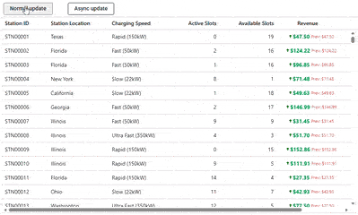

# High Frequency Cell Updates in ASP.NET Core Data Grid

The ASP.NET Core Data Grid provides methods to update cell values programmatically, both synchronously and asynchronously. These methods are particularly useful for simulating high-frequency updates, where performance differences between synchronous and asynchronous operations can be evaluated.

* `setCellValue`: Which applies the change synchronously to the cell value.
* `setCellValueAsync`: Which returns a `Promise` that resolves after the update is complete, including any data request. Use this method when the update involves a server call, or a following action should wait until it finishes.

Clicking "Normal update" updates the "Revenue" value synchronously using `setCellValue`, while clicking "Async update" updates the "Revenue" value asynchronously using `setCellValueAsync`.










> The primary key column must be specified using the [isPrimaryKey](https://help.syncfusion.com/cr/aspnetcore-js2/Syncfusion.EJ2.Grids.GridColumn.html#Syncfusion_EJ2_Grids_GridColumn_IsPrimaryKey) property so the Data Grid can locate the cell being updated.
