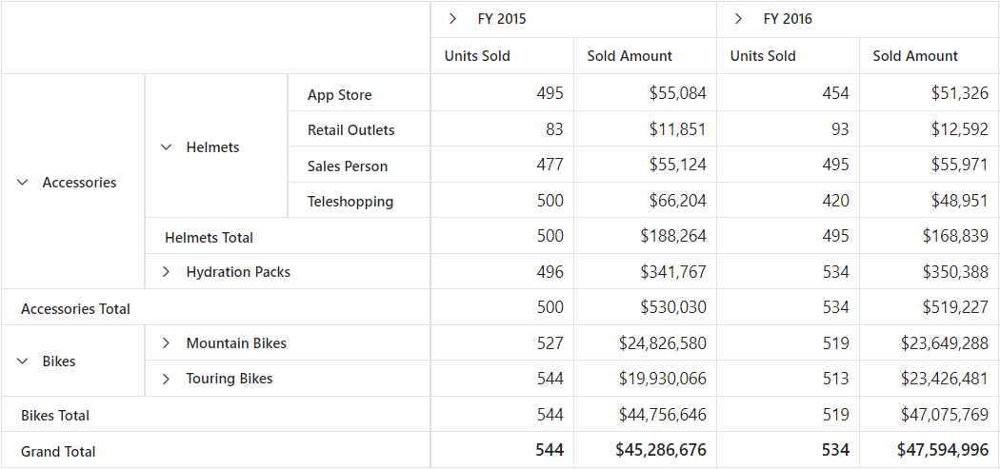

# Layout in ASP.NET Core Pivot Table

The Syncfusion&reg; ASP.NET Core Pivot Table supports three visual layouts to present data according to different analytical needs:

* **Default Compact**: Displays row fields hierarchically in a stepped, tree-like structure within a single column.
* **Classic (Tabular)**: Displays row fields side by side in separate columns with subtotals per group and grand totals.
* **Flat**: Displays raw, unaggregated relational records directly in a flat tabular grid view.

## Default Compact Layout

The compact layout is the default visual presentation of the Pivot Table. In this layout, fields placed on the row axis are rendered in a single column using an expandable and collapsible stepped hierarchy, which saves horizontal space while preserving the parent-child relationships between grouped rows.

The compact layout is active by default. You can also explicitly specify it by setting the [layout](https://help.syncfusion.com/cr/aspnetcore-js2/Syncfusion.EJ2.PivotView.PivotViewGridSettings.html#Syncfusion_EJ2_PivotView_PivotViewGridSettings_Layout) property in the [e-gridSettings](https://help.syncfusion.com/cr/aspnetcore-js2/Syncfusion.EJ2.PivotView.PivotViewGridSettings.html) tag to **Compact**.

## Classic Layout

N> The classic layout is compatible only with relational data sources and operates in both client-side and server-side engines.

The classic layout, also known as the tabular layout, in the Syncfusion&reg; Pivot Table provides a structured, tabular presentation of data that enhances readability and usability. In this layout, fields in the row axis are displayed side by side in separate columns, making data interpretation and analysis easier. By default, grand totals appear at the end of all rows, while subtotals are placed in a separate row beneath each group. All other features of the pivot table, such as filtering, sorting, drag-and-drop, expand/collapse functionality, and more, remain the same as in the compact layout, which serves as the default hierarchical format of the pivot table.

To enable the classic layout, set the [layout](https://help.syncfusion.com/cr/aspnetcore-js2/Syncfusion.EJ2.PivotView.PivotViewGridSettings.html#Syncfusion_EJ2_PivotView_PivotViewGridSettings_Layout) property in the [e-gridSettings](https://help.syncfusion.com/cr/aspnetcore-js2/Syncfusion.EJ2.PivotView.PivotViewGridSettings.html) tag to **Tabular**.










### Limitations

* Subtotals at the "Top" position are not supported for row subtotals.

## Flat Analytical Table View

By default, the Pivot Table aggregates relational data in the Compact or Tabular layout. The `Flat` layout instead displays the raw, unaggregated relational records in a tabular view without altering the pivot report configuration. It works directly on the [dataSource](https://help.syncfusion.com/cr/aspnetcore-js2/Syncfusion.EJ2.PivotView.PivotViewDataSourceSettings.html) of the `dataSourceSettings` and does not trigger any pivot engine population events.

To enable it, set the [layout](https://help.syncfusion.com/cr/aspnetcore-js2/Syncfusion.EJ2.PivotView.PivotViewGridSettings.html#Syncfusion_EJ2_PivotView_PivotViewGridSettings_Layout) property in `gridSettings` to **Flat** and inject the `FlatLayout` module by calling `ej.pivotview.PivotView.Inject(ej.pivotview.FlatLayout)` in a script block. Configure the flat view independently using `flatSettings`, which supports `columns`, `allowSorting`, `sortSettings`, `allowFiltering`, `filterSettings`, `allowAdvancedFiltering`, `searchSettings`, `allowPaging`, `pageSettings`, `enableVirtualization`, `aggregates`, `totalsPosition` and `showColumnChooser`. When the toolbar is enabled, add the `Layout` item to the `toolbar` array to let users switch between the Compact, Tabular and Flat layouts.

N> The Flat layout is supported only for relational data sources; OLAP is not supported. Switching layouts preserves the original pivot report state.












