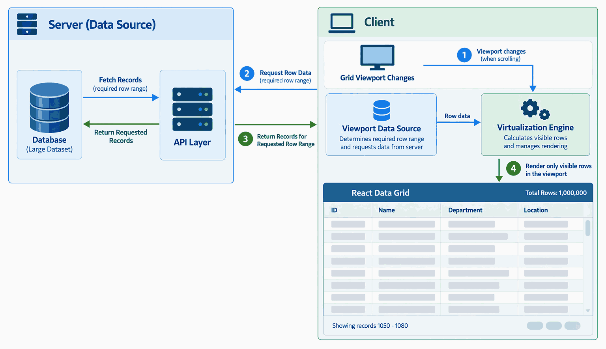

# Viewport Row Model in ASP.NET MVC Data Grid

The Syncfusion&reg; ASP.NET MVC Data Grid supports rendering data based on the active viewport. Instead of rendering all available records, the Data Grid renders only the rows visible within the viewport, reducing DOM overhead and improving rendering performance. By default, the Data Grid uses DOM virtualization ([EnableDomVirtualization](https://help.syncfusion.com/cr/aspnetmvc-js2/Syncfusion.EJ2.Grids.Grid.html#Syncfusion_EJ2_Grids_Grid_EnableDomVirtualization)) to maintain only the visible rows in the DOM.

The Data Grid extends this viewport-driven rendering mechanism to remote data sources. Records are retrieved from the server on demand, and the server returns the requested result set. The Data Grid then uses DOM virtualization to render only the rows visible within the active viewport, regardless of the number of records returned. This ensures that data retrieval and row rendering are scoped to the active viewport, minimizing DOM footprint.

As scrolling updates the viewport, the Data Grid retrieves the required row range and refreshes the rendered content accordingly. DOM virtualization ensures that only rows within the active viewport are maintained in the DOM.

[Paging](https://help.syncfusion.com/grid-sdk/asp-net-mvc/data-grid/paging), [infinite scrolling](https://help.syncfusion.com/grid-sdk/asp-net-mvc/data-grid/scrolling/infinite-scrolling), and [virtual scrolling](https://help.syncfusion.com/grid-sdk/asp-net-mvc/data-grid/scrolling/virtual-scrolling) are built on this viewport-driven rendering mechanism. By rendering only the rows required for the active viewport, the Data Grid reduces rendering overhead, minimizes client-side memory consumption, and maintains consistent performance regardless of dataset size.

In the following sample, the Data Grid renders only the rows currently visible within the viewport in the DOM.










## Viewport buffer settings

The viewport buffer determines the number of additional rows rendered outside the visible viewport. Buffered elements help maintain a smooth scrolling experience by keeping adjacent content available for rendering.

The number of buffered rows is configured through the `RowBuffer` property of `DomVirtualizationSettings`. By default, the Data Grid renders `5` additional rows beyond the visible viewport.










## Server-side data operations

The Data Grid supports server-side execution of data operations such as sorting, filtering, searching, and paging. The Data Grid sends the requested operation details as part of the query, and the server processes the operation against the complete dataset and returns the requested records to the Data Grid.

After the data is received, the Data Grid uses DOM virtualization to render only the rows visible within the viewport.

In the following sample, a local in-memory data source simulates the server. Custom binding is used through the [DataStateChange](https://help.syncfusion.com/cr/aspnetmvc-js2/Syncfusion.EJ2.Grids.Grid.html#Syncfusion_EJ2_Grids_Grid_DataStateChange) event: each viewport request is processed by custom logic that applies the filter, sort, and paging details to the local data and supplies only the requested records to the Data Grid.










## See also

* [Remote data](https://help.syncfusion.com/grid-sdk/asp-net-mvc/data-grid/data-binding/remote-data)
* [Enable editing](https://help.syncfusion.com/grid-sdk/asp-net-mvc/data-grid/editing/edit)
* [Custom binding](https://help.syncfusion.com/grid-sdk/asp-net-mvc/data-grid/data-binding/remote-data#custom-binding)
