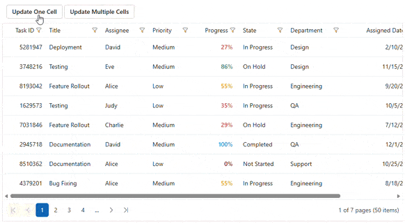

# Cell Value Update in ASP.NET MVC Data Grid

The ASP.NET MVC Data Grid provides methods to update an existing cell's data programmatically, without direct interaction with the grid interface. Two available methods are:

* `setCellValue`: Which applies the change synchronously to the cell value.
* `setCellValueAsync`: Which returns a `Promise` that resolves after the update is complete, including any remote data request. Use this method when the update involves a server call, or a following action should wait until it finishes.

The "Progress" field in the row with "Task ID = 8193042" is updated synchronously using `setCellValue`, while multiple "Progress" cells across different rows are updated asynchronously using `setCellValueAsync`.










> The primary key column must be specified using the [IsPrimaryKey](https://help.syncfusion.com/cr/aspnetmvc-js2/Syncfusion.EJ2.Grids.GridColumn.html#Syncfusion_EJ2_Grids_GridColumn_IsPrimaryKey) property so the Data Grid can locate the row whose cell is being updated.
