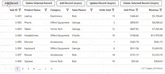

# Data Transition in ASP.NET MVC Data Grid

The ASP.NET MVC Data Grid provides methods to add, edit, and delete records programmatically, without direct interaction with the grid interface. These methods support both synchronous and asynchronous execution, enabling flexible control over record editing.

* `addRecord`: Starts a new entry. If no data is passed, a blank form opens for input.
* `startEdit`: Enables edit mode for the selected row.
* `deleteRecord`: Removes the selected row.
* `addRecordAsync`: Adds a new record asynchronously to the grid by passing the new data object.
* `updateRowAsync`: Updates a specific row asynchronously by passing the new data object for that row.
* `deleteRecordAsync`: Removes a record asynchronously from the grid by passing the primary key value and the corresponding data to identify the row.

A single record is added synchronously using `addRecord`, while two records are added asynchronously using `addRecordAsync`. Additionally, the record at index "1" is updated asynchronously using `updateRowAsync`.










> `addRecordAsync`, `updateRowAsync` and `deleteRecordAsync` return a `Promise` that resolves after the update is complete, including any data request. Use these methods when adding or removing a record, or updating an existing row involves a server call, or a following action should wait until it finishes.
