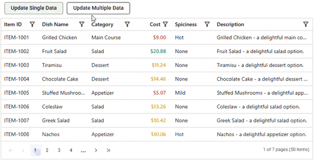

# Row Data Update in ASP.NET MVC Data Grid

The ASP.NET MVC Data Grid provides methods to update an existing row's data programmatically, without direct interaction with the grid interface. Two available methods are

* `setRowData`: Which applies the change synchronously to the row data.
* `setRowDataAsync`: Which returns a `Promise` that resolves after the update is complete, including any remote data request. Use this method when the update involves a server call, or a following action should wait until it finishes.

Clicking "Update Single Data" updates the "Cost" value of the row "ITEM-1002" using `setRowData`, while clicking "Update Multiple Data" updates the "Cost" values of rows "ITEM-1001", "ITEM-1002", and "ITEM-1003" asynchronously using `setRowDataAsync`.










> The primary key column must be specified using the [IsPrimaryKey](https://help.syncfusion.com/cr/aspnetmvc-js2/Syncfusion.EJ2.Grids.GridColumn.html#Syncfusion_EJ2_Grids_GridColumn_IsPrimaryKey) property so the Data Grid can locate the row that needs to be updated.
