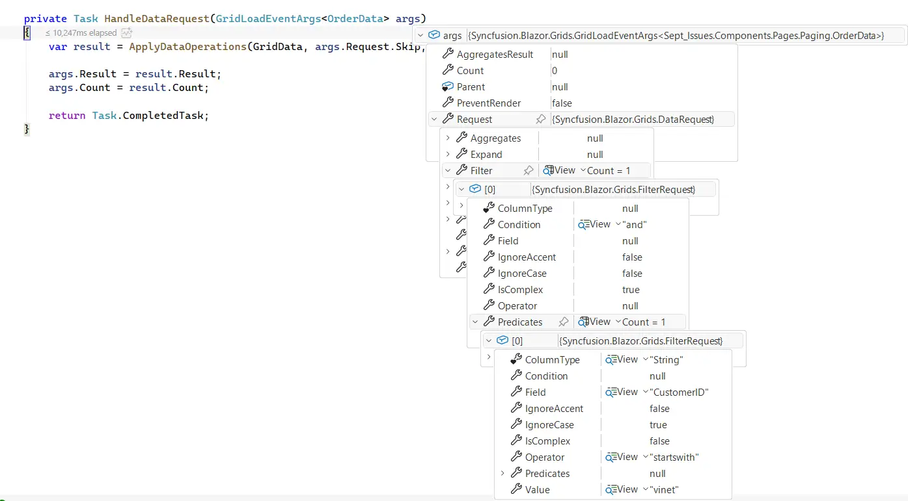
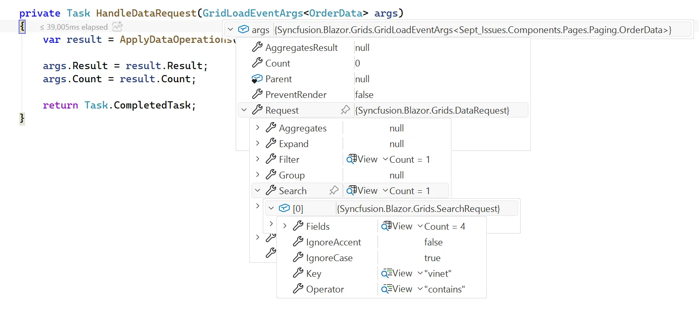
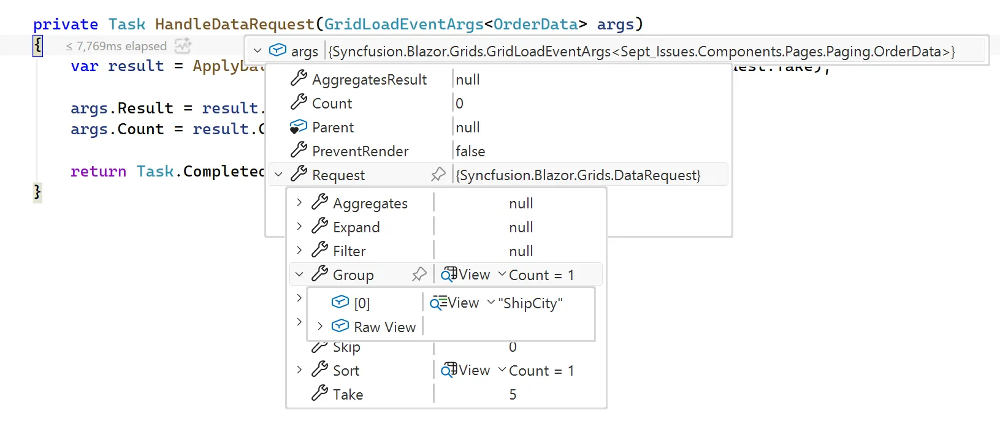
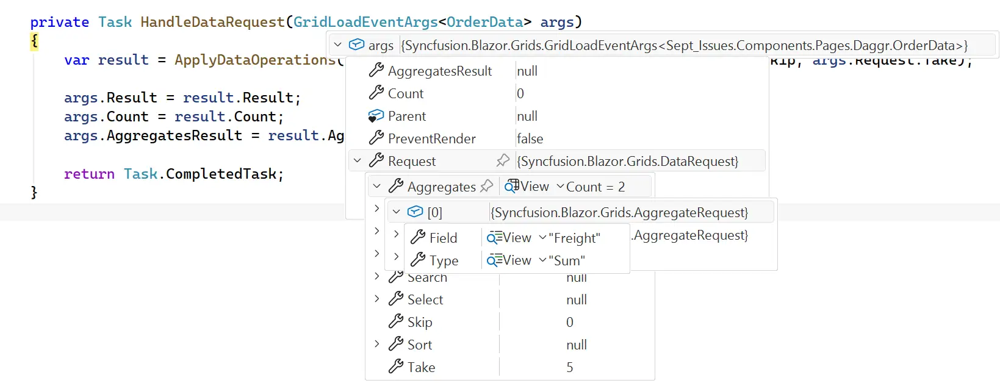

# Event-Driven Data Binding in Blazor Data Grid

Event-driven data binding enables the Data Grid to retrieve data through the [OnDataLoad]((https://help.syncfusion.com/cr/blazor/Syncfusion.Blazor.Grids.GridEvents-1.html#Syncfusion_Blazor_Grids_GridEvents_1_OnDataLoad)) event instead of using built-in data adaptors. Each paging, sorting, filtering, searching, or grouping operation triggers the `OnDataLoad` event so the application can fetch and return data from custom services, APIs, databases, or repositories.

Event-driven data binding is ideal for the following scenarios:

- **REST API integration**: Fetch data from remote APIs with custom headers, authentication, or pagination logic.
- **Server-side operations**: Perform all filtering, sorting, and searching on the server to optimize performance with large datasets.
- **Large datasets**: Handle datasets too large to load entirely in memory by retrieving only the current page of data.
- **Repository pattern**: Implement clean architecture by centralizing data retrieval logic in dedicated repositories or services.
- **Custom business logic**: Apply authorization rules, caching strategies, data validation, or computed columns before displaying data.

**Configure OnDataLoad event properties**

The `OnDataLoad` event provides the [args.Request](https://help.syncfusion.com/cr/blazor/Syncfusion.Blazor.Grids.GridLoadEventArgs-1.html#Syncfusion_Blazor_Grids_GridLoadEventArgs_1_Request) object, which contains details about the current data operation. Based on the request information in `args.Request`, the event handler must process the data and populate the required response properties. The request and response properties work together to enable the Data Grid to retrieve and display the correct set of records. Understanding the purpose of these properties is essential for implementing custom data loading logic effectively.

**Request Properties**

The `args.Request` object contains the following properties that describe the current grid operation:

| Request Property | Type | Description |
|------------------|------|-------------|
| [Skip](https://help.syncfusion.com/cr/blazor/Syncfusion.Blazor.Grids.DataRequest.html#Syncfusion_Blazor_Grids_DataRequest_Skip) | int | The number of records to skip from the start. Used for pagination to show different pages. Default is `0`. |
| [Take](https://help.syncfusion.com/cr/blazor/Syncfusion.Blazor.Grids.DataRequest.html#Syncfusion_Blazor_Grids_DataRequest_Take) | int | The number of records to retrieve. Specifies how many rows to display on the current page. Default is `0`. |
| [Sort](https://help.syncfusion.com/cr/blazor/Syncfusion.Blazor.Grids.DataRequest.html#Syncfusion_Blazor_Grids_DataRequest_Sort) | List<SortRequest>? | The fields to sort by and the sort order for each field (ascending or descending). Null when no sorting is applied. |
| [Filter](https://help.syncfusion.com/cr/blazor/Syncfusion.Blazor.Grids.DataRequest.html#Syncfusion_Blazor_Grids_DataRequest_Filter) | List<FilterRequest>? | The filter conditions to apply to the data by field name, operator, and value. Null when no filters are applied. |
| [Search](https://help.syncfusion.com/cr/blazor/Syncfusion.Blazor.Grids.DataRequest.html#Syncfusion_Blazor_Grids_DataRequest_Search) | List<SearchRequest>? | The search keywords and the fields to search across. Null when no search is applied. |
| [Group](https://help.syncfusion.com/cr/blazor/Syncfusion.Blazor.Grids.DataRequest.html#Syncfusion_Blazor_Grids_DataRequest_Group) | List<string>? | The field names to group data by. Null when no grouping is applied. |
| [Aggregates](https://help.syncfusion.com/cr/blazor/Syncfusion.Blazor.Grids.DataRequest.html#Syncfusion_Blazor_Grids_DataRequest_Aggregates) | List<AggregateRequest>? | The aggregate calculations to perform (Sum, Average, Count, Min, Max). Null when no aggregates are requested. |
| [Select](https://help.syncfusion.com/cr/blazor/Syncfusion.Blazor.Grids.DataRequest.html#Syncfusion_Blazor_Grids_DataRequest_Select) | List<string>? | The specific columns to return in the results. Null to return all columns. |
| [Expand](https://help.syncfusion.com/cr/blazor/Syncfusion.Blazor.Grids.DataRequest.html#Syncfusion_Blazor_Grids_DataRequest_Expand) | List<string>? | Related data to include with the main records. Null when no related data is needed. |

**Response Properties**

The event uses the [GridLoadEventArgs](https://help.syncfusion.com/cr/blazor/Syncfusion.Blazor.Grids.GridLoadEventArgs-1.html) class, which includes the following properties that must be set by the event handler:

| Response Property | Type | Description |
|-------------------|------|-------------|
| [Result](https://help.syncfusion.com/cr/blazor/Syncfusion.Blazor.Grids.GridLoadEventArgs-1.html#Syncfusion_Blazor_Grids_GridLoadEventArgs_1_Result) | IEnumerable<TValue> | Contains the data operation details for the current grid action. |
| [Count](https://help.syncfusion.com/cr/blazor/Syncfusion.Blazor.Grids.GridLoadEventArgs-1.html#Syncfusion_Blazor_Grids_GridLoadEventArgs_1_Count) | int | The total number of records that match the current filters and search, without pagination limits. |
| [AggregatesResult](https://help.syncfusion.com/cr/blazor/Syncfusion.Blazor.Grids.GridLoadEventArgs-1.html#Syncfusion_Blazor_Grids_GridLoadEventArgs_1_AggregatesResult) | IDictionary<string, object>? | The calculated aggregate values (like totals and averages) to display in the footer. |

---

## Handling paging operation

Paging triggers the `OnDataLoad` event and provides paging details through `args.Request.Skip` and `args.Request.Take`. Retrieve the required page records and return the results through `args.Result` and the total record count through `args.Count`.




@using Syncfusion.Blazor.Grids

<SfGrid TValue="OrderData" AllowPaging="true">
    <GridEvents OnDataLoad="HandleDataRequest" TValue="OrderData"></GridEvents>
    <GridPageSettings PageSize="5"></GridPageSettings>
    <GridColumns>
        <GridColumn Field="@nameof(OrderData.OrderID)" HeaderText="Order ID" IsPrimaryKey="true" TextAlign="TextAlign.Right" Width="120"></GridColumn>
        <GridColumn Field="@nameof(OrderData.CustomerID)" HeaderText="Customer ID" Width="150"></GridColumn>
        <GridColumn Field="@nameof(OrderData.ShipCity)" HeaderText="Ship City" Width="150"></GridColumn>
    </GridColumns>
</SfGrid>

@code {
    private List<OrderData> GridData { get; set; } = new();

    protected override void OnInitialized()
    {
        GridData = OrderData.GetAllRecords();
    }

    private Task HandleDataRequest(GridLoadEventArgs<OrderData> args)
    {
        var result = ApplyDataOperations(GridData, args.Request.Skip, args.Request.Take);
        args.Result = result.Result;
        args.Count = result.Count;
        return Task.CompletedTask;
    }

    private static (IEnumerable<T> Result, int Count) ApplyDataOperations<T>(IEnumerable<T> source, int skip, int take)
    {
        var count = source.Count();
        source = source.Skip(skip).Take(take);
        return (source, count);
    }
}




public class OrderData
{
    private static readonly List<OrderData> Orders = new();

    public OrderData(int? orderId, string customerId, string shipCity)
    {
        OrderID = orderId;
        CustomerID = customerId;
        ShipCity = shipCity;
    }

    public static List<OrderData> GetAllRecords()
    {
        if (Orders.Count == 0)
        {
            Orders.AddRange(
                Enumerable.Range(1, 100)
                    .Select(index => new OrderData(
                        10248 + index,
                        new[] { "VINET", "TOMSP", "HANAR", "VICTE", "SUPRD", "CHOPS", "RICSU", "WELLI" }[index % 8],
                        new[] { "Reims", "Münster", "Rio de Janeiro", "Lyon", "Charleroi", "London", "Berlin", "Madrid" }[index % 8]
                    ))
            );
        }

        return Orders;
    }

    public int? OrderID { get; set; }
    public string CustomerID { get; set; }
    public string ShipCity { get; set; }
}






---

## Handling sorting operation

Sorting triggers the `OnDataLoad` event and provides the sort criteria through `args.Request.Sort`. Apply the sorting logic to the data source and return the sorted records through `args.Result` and the total record count through `args.Count`.




@using Syncfusion.Blazor.Grids

<SfGrid TValue="OrderData" AllowSorting="true" AllowPaging="true">
    <GridEvents OnDataLoad="HandleDataRequest" TValue="OrderData"></GridEvents>
    <GridColumns>
        <GridColumn Field="@nameof(OrderData.OrderID)" HeaderText="Order ID" IsPrimaryKey="true" TextAlign="TextAlign.Right" Width="140"></GridColumn>
        <GridColumn Field="@nameof(OrderData.CustomerID)" HeaderText="Customer ID" Width="180"></GridColumn>
        <GridColumn Field="@nameof(OrderData.Freight)" HeaderText="Freight" Format="C2" Width="150"></GridColumn>
    </GridColumns>
</SfGrid>

@code {
    private List<OrderData> GridData { get; set; } = new();

    protected override void OnInitialized()
    {
        GridData = OrderData.GetAllRecords();
    }

    private Task HandleDataRequest(GridLoadEventArgs<OrderData> args)
    {
        var result = ApplyDataOperations(GridData, args.Request.Sort, args.Request.Skip, args.Request.Take);
        args.Result = result.Result;
        args.Count = result.Count;
        return Task.CompletedTask;
    }

    private static (IEnumerable<T> Result, int Count) ApplyDataOperations<T>(IEnumerable<T> source, List<SortRequest>? sorted, int skip, int take)
    {
        var sort = sorted?.FirstOrDefault();
        if (sort != null)
        {
            var property = typeof(OrderData).GetProperty(sort.Name!);
            if (property != null)
            {
                source = sort.Direction == "ascending" ? source.OrderBy(x => property.GetValue(x)) : source.OrderByDescending(x => property.GetValue(x));
            }
        }
        var count = source.Count();
        if (skip != 0 || take != 0)
        {
            source = source.Skip(skip).Take(take);
        }
        return (Result: source, Count: count);
    }
}




public class OrderData
{
    private static readonly List<OrderData> Orders = new();

    public OrderData(int orderId, string customerId, double freight)
    {
        OrderID = orderId;
        CustomerID = customerId;
        Freight = freight;
    }

    public static List<OrderData> GetAllRecords()
    {
        if (Orders.Count == 0)
        {
            string[] customers = { "VINET", "TOMSP", "HANAR", "VICTE", "SUPRD", "CHOPS", "RICSU", "WELLI" };
            double[] freightValues = { 32.38, 11.61, 65.83, 41.34, 51.30, 58.17, 22.98, 148.33, 13.97 };
            Orders.AddRange(
                Enumerable.Range(1, 100)
                    .Select(i => new OrderData(
                        10247 + i,
                        customers[(i - 1) % customers.Length],
                        freightValues[(i - 1) % freightValues.Length]
                    ))
            );
        }
        return Orders;
    }

    public int OrderID { get; set; }
    public string CustomerID { get; set; }
    public double Freight { get; set; }
}






---

## Handling filtering operation

Filtering triggers the `OnDataLoad` event and provides filter definitions through `args.Request.Filter`. Apply the filtering criteria to the data source and return the filtered records through `args.Result` and the total matching record count through `args.Count`. This ensures that only records matching the specified criteria are displayed in the Data Grid.

**Filter request structure**

When filtering is applied to the Data Grid, the `args.Request.Filter` property contains a list of `FilterRequest` objects. Each `FilterRequest` object specifies the field to filter, the operator (equals, contains, greater than, etc.), the filter value, and additional options like case-sensitivity and accent handling. The following debugger snapshot shows the request payload generated by the Data Grid when filters are applied:

Map each `FilterRequest` in the custom implementation to a database or API query, then return the filtered records through `args.Result` and the total filtered record count through `args.Count`.

---

## Handling searching operation

Searching triggers the `OnDataLoad` event and provides search criteria through `args.Request.Search`. Apply the search criteria to the data source and return the matching records through `args.Result` and the total matching record count through `args.Count`. This ensures that only records matching the search criteria are displayed in the Data Grid.

**Search request structure**

When a search is performed in the Data Grid, the `args.Request.Search` property contains a list of `SearchRequest` objects. Each `SearchRequest` object specifies which fields to search within, the search keyword, the search operator (contains, starts with, ends with, etc.), and options for case-sensitivity and accent handling. The following debugger snapshot shows the request payload generated during a search:

Map each `SearchRequest` to the corresponding backend query logic, then return the matching records through `args.Result` and the total matching record count through `args.Count`.

---

## Handling grouping operation

Grouping triggers the `OnDataLoad` event and provides grouping information through `args.Request.Group`. Apply the grouping logic to the data source and return the grouped records through `args.Result` along with the total record count through `args.Count`. This ensures that records are organized and displayed by the specified group criteria in the Data Grid.

**Group request structure**

When grouping is applied to the Data Grid, the `args.Request.Group` property contains a list of field names that define the grouping hierarchy. For example, grouping by "Category" and then "Status" creates nested groups. The following debugger snapshot shows the group field list generated by the Data Grid:

The implementation must create the group hierarchy in the service layer or repository, then return the grouped records through `args.Result` and the total record count through `args.Count`.

---

## Handling aggregates operation

Aggregates trigger the `OnDataLoad` event and provide the aggregate definitions through `args.Request.Aggregates`. Calculate the required summary values and return the records through `args.Result` and the aggregate results through `args.AggregatesResult` to display summaries in the Data Grid.

**Aggregate request structure**

When aggregate calculations are configured in the Data Grid, the `args.Request.Aggregates` property contains a list of aggregate definitions. Each definition specifies the field for which aggregate values are required and the aggregate types to calculate, such as sum, average, count, minimum, or maximum. The following debugger snapshot shows the request payload generated by the Data Grid when aggregate calculations are requested.

Calculate the aggregate values requested in `args.Request.Aggregates` and return the results through `args.AggregatesResult`.

---

## Handling CRUD operation

Event-driven data binding requires explicit handling of changes. The Data Grid notifies the application through dedicated events such as `RowUpdating` and `RowDeleting` when records are added, edited, or deleted. These events provide a reliable mechanism to capture and respond to data modifications, allowing the application to validate changes, apply business logic, maintain data integrity, and save modifications to the data source.

- **RowUpdating** - Triggered when a record is added or edited. Access the record through` args.Data` and use `args.Action` to determine whether to insert a new record or update an existing record.

- **RowDeleting** - Triggered when one or more records are deleted. Access the records through `args.Datas` and remove the corresponding records from the data source.




@using Syncfusion.Blazor.Grids

<SfGrid TValue="SupportTicket" AllowPaging="true" Toolbar="@(new List<string>() { "Add", "Edit", "Delete", "Update", "Cancel" })">
    <GridEvents TValue="SupportTicket" OnDataLoad="HandleDataRequest" RowUpdating="UpdateHandler" RowDeleting="DeleteHandler"></GridEvents>
    <GridEditSettings AllowEditing="true" AllowDeleting="true" AllowAdding="true" Mode="@EditMode.Normal"></GridEditSettings>
    <GridPageSettings PageSize="12"></GridPageSettings>
    <GridColumns>
        <GridColumn Field="@nameof(SupportTicket.TicketId)" HeaderText="Ticket ID" IsPrimaryKey="true" ValidationRules="@(new ValidationRules { Required = true, Number = true })" TextAlign="TextAlign.Right" Width="120"></GridColumn>
        <GridColumn Field="@nameof(SupportTicket.CustomerName)" HeaderText="Customer" ValidationRules="@(new ValidationRules { Required = true })" Width="180"></GridColumn>
        <GridColumn Field="@nameof(SupportTicket.Product)" HeaderText="Product" ValidationRules="@(new ValidationRules { Required = true })" Width="180"></GridColumn>
        <GridColumn Field="@nameof(SupportTicket.Priority)" HeaderText="Priority" Width="120"></GridColumn>
        <GridColumn Field="@nameof(SupportTicket.Status)" HeaderText="Status" Width="140"></GridColumn>
        <GridColumn Field="@nameof(SupportTicket.CreatedOn)" HeaderText="Created On" Type="ColumnType.Date" Format="d" Width="140"></GridColumn>
    </GridColumns>
</SfGrid>

@code {
    private List<SupportTicket> GridData { get; set; } = new();

    protected override void OnInitialized()
    {
        GridData = SupportTicket.GetAllRecords();
    }

    private Task HandleDataRequest(GridLoadEventArgs<SupportTicket> args)
    {
        var result = ApplyDataOperations(GridData, args.Request.Skip, args.Request.Take);
        args.Result = result.Result;
        args.Count = result.Count;
        return Task.CompletedTask;
    }

    private void UpdateHandler(RowUpdatingEventArgs<SupportTicket> args)
    {
        if (args.Action == SaveActionType.Edited)
        {
            var record = GridData.FirstOrDefault(x => x.TicketId == args.Data.TicketId);
            if (record != null)
            {
                record.CustomerName = args.Data.CustomerName;
                record.Product = args.Data.Product;
                record.Priority = args.Data.Priority;
                record.Status = args.Data.Status;
                record.CreatedOn = args.Data.CreatedOn;
            }
        }
        else
        {
            GridData.Insert(args.Index, args.Data);
        }
    }

    private void DeleteHandler(RowDeletingEventArgs<SupportTicket> args)
    {
        var ticketId = ((SupportTicket)args.Datas[0]).TicketId;
        var record = GridData.FirstOrDefault(x => x.TicketId == ticketId);
        if (record != null)
        {
            GridData.Remove(record);
        }
    }

    private static (IEnumerable<T> Result, int Count) ApplyDataOperations<T>(IEnumerable<T> source, int skip, int take)
    {
        var count = source.Count();
        source = source.Skip(skip).Take(take);
        return (source, count);
    }
}




public class SupportTicket
{
    private static readonly List<SupportTicket> Tickets = new();
    public static List<SupportTicket> GetAllRecords()
    {
        if (Tickets.Count == 0)
        {
            Tickets.AddRange(
                Enumerable.Range(1, 100)
                    .Select(index => new SupportTicket
                    {
                        TicketId = 5000 + index,
                        CustomerName = new[] { "Margaret Peacock", "Steven Buchanan", "Alexander Feuer", "Patricia McKenna", "Renate Messner", "Maria Anders", "Thomas Hardy", "Elizabeth Brown" }[index % 8],
                        Product = new[] { "Analytics Dashboard", "Workflow Engine", "Reporting Service", "Document Manager", "Data Connector" }[index % 5],
                        Priority = new[] { "Low", "Medium", "High", "Critical" }[index % 4],
                        Status = new[] { "Open", "In Progress", "Resolved", "Escalated", "Closed" }[index % 5],
                        CreatedOn = new DateTime(2024, 1, 1).AddDays(index % 90)
                    }));
        }

        return Tickets;
    }

    public int TicketId { get; set; }
    public string CustomerName { get; set; } = string.Empty;
    public string Product { get; set; } = string.Empty;
    public string Priority { get; set; } = string.Empty;
    public string Status { get; set; } = string.Empty;
    public DateTime CreatedOn { get; set; }
}






## Handling batch operations

Batch editing allows multiple records to be added, modified, and deleted before saving. When changes are committed, the `OnBatchSave` event is triggered and provides all pending changes through `args.BatchChanges`.

- **OnBatchSave** - Triggered when batch changes are saved. Access added records through AddedRecords, modified records through ChangedRecords, and deleted records through DeletedRecords from `args.BatchChanges` and process all changes in a single operation.




@using Syncfusion.Blazor.Grids

<SfGrid TValue="OrderData" Toolbar="@(new List<string>() { "Add", "Edit", "Delete", "Update", "Cancel" })" AllowPaging="true">
    <GridEvents OnDataLoad="HandleDataRequest" OnBatchSave="BatchSaveHandler" TValue="OrderData"></GridEvents>
    <GridEditSettings AllowEditing="true" AllowDeleting="true" AllowAdding="true" Mode="@EditMode.Batch"></GridEditSettings>
    <GridColumns>
        <GridColumn Field="@nameof(OrderData.OrderID)" HeaderText="Order ID" IsPrimaryKey="true" ValidationRules="@(new ValidationRules { Required = true, Number = true })" TextAlign="TextAlign.Right" Width="140"></GridColumn>
        <GridColumn Field="@nameof(OrderData.CustomerID)" HeaderText="Customer ID" ValidationRules="@(new ValidationRules { Required = true })" Width="180"></GridColumn>
        <GridColumn Field="@nameof(OrderData.Freight)" HeaderText="Freight" Format="C2" Width="150"></GridColumn>
    </GridColumns>
</SfGrid>

@code {
    private List<OrderData> GridData { get; set; } = new();

    protected override void OnInitialized()
    {
        GridData = OrderData.GetAllRecords();
    }

    private Task HandleDataRequest(GridLoadEventArgs<OrderData> args)
    {
        var result = ApplyDataOperations(GridData, args.Request.Skip, args.Request.Take);
        args.Result = result.Result;
        args.Count = result.Count;
        return Task.CompletedTask;
    }

    private Task BatchSaveHandler(BeforeBatchSaveArgs<OrderData> args)
    {
        var batchChanges = args.BatchChanges;

        if (batchChanges.ChangedRecords != null)
        {
            foreach (var record in batchChanges.ChangedRecords)
            {
                var data = GridData.FirstOrDefault(x => x.OrderID == record.OrderID);

                if (data != null)
                {
                    data.CustomerID = record.CustomerID;
                    data.Freight = record.Freight;
                }
            }
        }

        if (batchChanges.AddedRecords != null)
        {
            foreach (var record in batchChanges.AddedRecords)
            {
                GridData.Insert(0, record);
            }
        }

        if (batchChanges.DeletedRecords != null)
        {
            foreach (var record in batchChanges.DeletedRecords)
            {
                GridData.RemoveAll(x => x.OrderID == record.OrderID);
            }
        }

        return Task.CompletedTask;
    }

    private static (IEnumerable<T> Result, int Count) ApplyDataOperations<T>(IEnumerable<T> source, int skip, int take)
    {
        var count = source.Count();
        source = source.Skip(skip).Take(take);
        return (source, count);
    }
}




public class OrderData
{
    private static readonly List<OrderData> Orders = new();
    public int OrderID { get; set; }
    public string CustomerID { get; set; } = string.Empty;
    public double Freight { get; set; }

    public static List<OrderData> GetAllRecords()
    {
        if (Orders.Count == 0)
        {
            Orders.AddRange(
                Enumerable.Range(1, 100).Select(index => new OrderData
                {
                    OrderID = 1000 + index,
                    CustomerID = new[] { "ALFKI", "ANANTR", "ANTON", "BLONP", "BOLID" }[index % 5],
                    Freight = 2.1 * index
                }));
        }

        return Orders;
    }
}






---

## Troubleshooting

| Issue | Likely cause | Resolution |
|---|---|---|
| Data Grid shows no data. | The `OnDataLoad` event handler is not configured. | Attach the handler to `<GridEvents OnDataLoad="HandlerMethod">` in the component. |
| Data Grid shows no data. | `args.Result` is not assigned or is empty. | Populate `args.Result` with the records to display in the Data Grid. |
| Pagination controls are disabled or show incorrect page count. | `args.Count` is set to the current page size instead of the total matching record count. | Assign `args.Count` to the full number of records that match the current filter and search state, not just the page size. |
| Filtered results are incomplete or missing. | Filter logic is not applied before assigning `args.Result`. | Apply the conditions from `args.Request.Filter` to the data source before returning records in `args.Result`. |
| Searched results are incomplete or missing. | Search logic is not applied before assigning `args.Result`. | Apply the conditions from `args.Request.Search` to the data source before returning records in `args.Result`. |
| Aggregate values (sum, average) do not appear in footer rows. | `args.AggregatesResult` is not populated. | Calculate the aggregate values and assign the values to `args.AggregatesResult`. |
| Aggregate values are incorrect after pagination. | Aggregate calculations are performed after `Skip` and `Take`. | Compute the aggregate values before pagination so the totals reflect the full filtered dataset. |
| Grouped data appears ungrouped. | Grouping logic is not applied to the records. | Apply the field names from `args.Request.Group` to create the group hierarchy before returning results. |
| Grouped data shows duplicate groups. | Group records are not organized according to the requested hierarchy. | Ensure each record belongs to one group path and maintain the full grouping hierarchy when returning `args.Result`. |

## See also

* [Grid Events](https://help.syncfusion.com/grid-sdk/blazor/data-grid/events)
* [Custom Adaptor](https://help.syncfusion.com/grid-sdk/blazor/data-grid/connecting-to-adaptors/custom-adaptor)
* [Local Data Binding](https://help.syncfusion.com/grid-sdk/blazor/data-grid/data-binding/local-data)
* [Remote Data Binding](https://help.syncfusion.com/grid-sdk/blazor/data-grid/data-binding/remote-data)