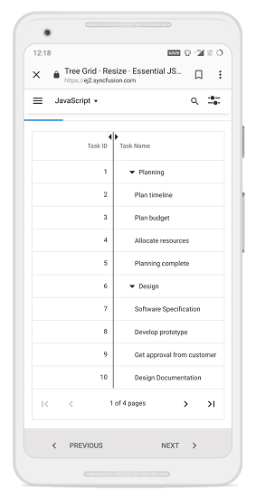

# Column Resizing in JavaScript TreeGrid

Column width can be resized by clicking and dragging the right edge of the column header. While dragging, the width of the respective column will be resized immediately. Each column can be auto resized by double-clicking the right edge of the column header to fit the width of that column based on the widest cell content. To enable column resize, set the [`allowResizing`](https://ej2.syncfusion.com/javascript/documentation/api/treegrid#allowresizing) property to true.

To use the column resize, inject `Resize` module in the treegrid.












> * You can disable resizing for a particular column by setting the [`columns.allowResizing`](https://ej2.syncfusion.com/javascript/documentation/api/treegrid/column#allowresizing) to false.
> * In RTL mode, you can click and drag the left edge of the header cell to resize the column.

## Min and max width

Column resize can be restricted between minimum and maximum width by defining the [`columns->minWidth`](https://ej2.syncfusion.com/javascript/documentation/api/treegrid/column#minwidth) and [`columns->maxWidth`](https://ej2.syncfusion.com/javascript/documentation/api/treegrid/column#maxwidth).

In the following sample, minimum and maximum width are defined for `Duration`, and `Task Name` columns.












## Resize stacked column

Stacked columns can be resized by clicking and dragging the right edge of the stacked column header. While dragging, the width of the respective child columns will be resized at the same time. You can disable resize for particular stacked column by setting `allowResizing` as `false` to its columns.












## Touch interaction

When the right edge of the header cell is tapped, a floating handler will be visible over the right border of the column. To resize the column, tap and drag the floating handler as needed.

The following screenshot represents the column resizing in touch device.

