> By default, the Pivot Table processes and displays data using its built-in engine with the given data source. Alternatively, you can use a server-side pivot engine to connect external data to the Pivot Table, which is especially useful when working with large datasets. This option is applicable only for relational data sources.

# Server-Side Pivot Engine in TypeScript Pivot Table

This section explains how to use the Syncfusion<sup style="font-size:70%">&reg;</sup> assembly [`Syncfusion.Pivot.Engine`](https://www.nuget.org/packages/Syncfusion.Pivot.Engine) in a server-side application. The server-side engine performs operations such as aggregation, filtering, sorting, and grouping on the server. Only the information required for the Pivot Table viewport is sent to the client through a web service (Web API), instead of transferring the entire data source. This approach helps reduce network traffic and improves Pivot Table rendering performance when working with large data sets. It works efficiently with the virtual scrolling option and supports all existing features in the Pivot Table.

## Quick steps to render the Pivot Table by using the server-side Pivot Engine

### Download and installing Server-side Pivot Engine

1. Download the ASP.NET Core-based standalone Pivot Table [application](https://github.com/SyncfusionExamples/server-side-pivot-engine-for-pivot-table) from the GitHub repository. This application includes all necessary files to set up and use the server-side Pivot Engine.

2. The downloaded **PivotController** application contains the following files to support data communication and processing:
   - **PivotController.cs** in the **Controllers** folder: Handles data communication between the server and the Pivot Table.
   - **DataSource.cs** in the **DataSource** folder: Defines the structure of the data sources using model classes.
   - Sample data source files, **sales.csv** and **sales-analysis.json**, in the **DataSource** folder: Provide example data for testing the Pivot Table.

3. Open the **PivotController** application in Visual Studio. The Syncfusion [Syncfusion.Pivot.Engine](https://www.nuget.org/packages/Syncfusion.Pivot.Engine) library will automatically download from nuget.org, enabling server-side calculations such as aggregation, filtering, and sorting for the Pivot Table.

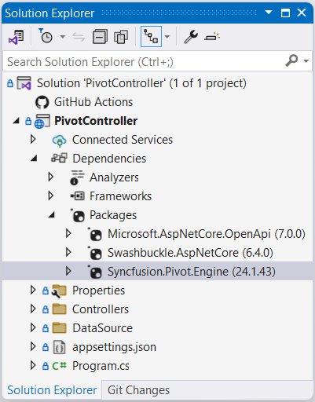

### Connecting Pivot Table to Server-side Pivot Engine

This section explains how to connect the Pivot Table to the server-side Pivot Engine to display data efficiently. Follow these steps to set up the connection and configure the Pivot Table using the server-side application created in the previous section.

1. **Start the server-side application**  
Run the **PivotController** application (downloaded and installed in the previous section) in Visual Studio. This hosts the server-side Pivot Engine on a local server, typically at a URL like `https://localhost:44350/api/pivot/post`. Ensure the application is running before proceeding.

2. **Configure the Pivot Table for server-side mode**  
In your Typescript application, update the Pivot Table’s settings to connect to the server-side Pivot Engine. Set the [`mode`](https://ej2.syncfusion.com/documentation/api/pivotview/datasourcesettingsmodel#mode) property in the [`dataSourceSettings`](https://ej2.syncfusion.com/documentation/api/pivotview/datasourcesettings) to `Server`. Then, specify the URL of the running **PivotController** application in the [`url`](https://ej2.syncfusion.com/documentation/api/pivotview/datasourcesettings#url) property.

```ts
import { PivotView } from '@syncfusion/ej2-pivotview';

let pivotObj: PivotView = new PivotView({
    dataSourceSettings: {
        url: 'https://localhost:44350/api/pivot/post',
        mode: 'Server',
        //Other codes here...
    }
});
pivotTableObj.appendTo('#PivotTable');

```

3. **Set up the Pivot Table report**  
Define the report to organize and display data from the server-side Pivot Engine. Use the [`dataSourceSettings`](https://ej2.syncfusion.com/documentation/api/pivotview/datasourcesettings) properties to specify rows, columns, values, and formatting based on the data source in the **PivotController** application (e.g., `sales.csv` or `sales-analysis.json`). For example, you can configure the report to show product details, sales amounts, and production years.

```ts
import { PivotView } from '@syncfusion/ej2-pivotview';

let pivotObj: PivotView = new PivotView({
    dataSourceSettings: {
        url: 'https://localhost:44350/api/pivot/post',
        mode: 'Server',
        rows: [{
            name: 'ProductID', caption: 'Product ID'
        }],
        formatSettings: [{
            name: 'Price', format: 'C'
        }],
        columns: [{
            name: 'Year', caption: 'Production Year'
        }],
        values: [
            { name: 'Sold', caption: 'Units Sold' },
            { name: 'Price', caption: 'Sold Amount' }
        ],
    }
    //Other codes here...
});
pivotTableObj.appendTo('#PivotTable');

```

4. **Run the Typescript application**  
Launch your Typescript application to view the Pivot Table. The Pivot Table will connect to the server-side Pivot Engine, retrieve the processed data, and display the results based on the configured report.


## Available configurations in Server-side application

This section explains how to set up and use different data sources with the server-side Pivot Engine in the Typescript [Pivot Table](https://ej2.syncfusion.com/documentation/pivotview/getting-started).

### Supportive Data Sources

The server-side Pivot Engine supports the following data sources:
- Collection
- JSON
- CSV
- DataTable
- Dynamic

#### Collection

The server-side pivot engine supports collection-based data sources, such as List or IEnumerable. You can bind these data sources using the `GetData` method in the server-side controller. In the Pivot Table, set the [`type`](https://ej2.syncfusion.com/documentation/api/pivotview/fieldoptionsmodel#type) property in the [`dataSourceSettings`](https://ej2.syncfusion.com/documentation/api/pivotview/datasourcesettings) to `JSON`, which is the default value.

In the server-side application, define the collection data source in the **DataSource.cs** file, as shown below:

```c#
public class PivotViewData
{
    public string ProductID { get; set; }
    public string Country { get; set; }
    public string Product { get; set; }
    public double Sold { get; set; }
    public double Price { get; set; }
    public string Year { get; set; }

    public List<PivotViewData> GetVirtualData()
    {
        List<PivotViewData> VirtualData = new List<PivotViewData>();

        for (int i = 1; i <= 10000; i++)
        {
            PivotViewData p = new PivotViewData
            {
                ProductID = "PRO-" + ((100 + i)%20),
                Year = (new string[] { "FY 2015", "FY 2016", "FY 2017", "FY 2018", "FY 2019" })[new Random().Next(5)],
                Country = (new string[] { "Canada", "France", "Australia", "Germany", "France" })[new Random().Next(5)],
                Product = (new string[] { "Car", "Van", "Bike", "Flight", "Bus" })[new Random().Next(5)],
                Price = (3.4 * i) + 500,
                Sold = (i * 15) + 10
            };
            VirtualData.Add(p);
        }
        return VirtualData;
    }
}

```

To bind this data source, set the model type **PivotViewData** to the **TValue** parameter of the **PivotEngine** class, as shown below:

```csharp
private PivotEngine<DataSource.PivotViewData> PivotEngine = new PivotEngine<DataSource.PivotViewData>();
```

Next, call the data source in the **GetData** method within the **PivotController.cs** file:

```csharp
public async Task<object> GetData(FetchData param)
{
    return await _cache.GetOrCreateAsync("dataSource" + param.Hash,
        async (cacheEntry) =>
        {
            cacheEntry.SetSize(1);
            cacheEntry.AbsoluteExpiration = DateTimeOffset.UtcNow.AddMinutes(60);

            // Here bind the collection type data source.
            return new DataSource.PivotViewData().GetVirtualData();

        });
}
```

Finally, configure the Pivot Table by setting the appropriate report in the [`dataSourceSettings`](https://ej2.syncfusion.com/documentation/api/pivotview/datasourcesettings) to match the data source, as shown below:

```ts
let pivotObj: PivotView = new PivotView({
    dataSourceSettings: {
        url: 'https://localhost:44350/api/pivot/post',
        mode: 'Server',
        type: 'JSON',
        rows: [{
            name: 'ProductID', caption: 'Product ID'
        }],
        formatSettings: [{
            name: 'Price', format: 'C'
        }],
        columns: [{
            name: 'Year', caption: 'Production Year'
        }],
        values: [
            { name: 'Sold', caption: 'Units Sold' },
            { name: 'Price', caption: 'Sold Amount' }
        ],
    }
    //Other codes here...
});

```

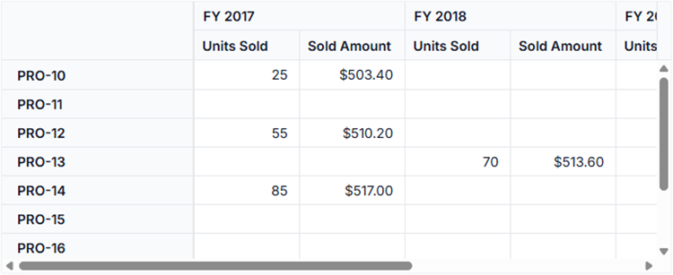

#### JSON

You can use JSON data from a local *.json file to connect to the Pivot Table. The file can be read using the **StreamReader**, which returns the content as a string. This string should then be converted into a collection that can be used with the server-side pivot engine.

In your server-side application, the **sales-analysis.json** file is located in the **DataSource** folder, and its model type is defined in the **DataSource.cs** file:

```csharp
public class PivotJSONData
{
    public string Date { get; set; }
    public string Sector { get; set; }
    public string EnerType { get; set; }
    public string EneSource { get; set; }
    public int PowUnits { get; set; }
    public int ProCost { get; set; }

    public List<PivotJSONData> ReadJSONData(string url)
    {
        WebClient myWebClient = new WebClient();
        Stream myStream = myWebClient.OpenRead(url);
        StreamReader stream = new StreamReader(myStream);
        string result = stream.ReadToEnd();
        stream.Close();
        return Newtonsoft.Json.JsonConvert.DeserializeObject<List<PivotJSONData>>(result);
    }
}
```

To use this data with the Pivot Table, assign the model type **PivotJSONData** to the **TValue** parameter of the **PivotEngine** class.

```csharp
private PivotEngine<DataSource.PivotJSONData> PivotEngine = new PivotEngine<DataSource.PivotJSONData>();
```

Next, retrieve the JSON data in the **GetData** method of the **PivotController.cs** file. This example shows how to load the **sales-analysis.json** file from the local server:

```csharp
public async Task<object> GetData(FetchData param)
{
    return await _cache.GetOrCreateAsync("dataSource" + param.Hash,
        async (cacheEntry) =>
        {
            cacheEntry.SetSize(1);
            cacheEntry.AbsoluteExpiration = DateTimeOffset.UtcNow.AddMinutes(60);

            // Here bind JSON type data source from the sales-analysis.json file.
            return new DataSource.PivotJSONData().ReadJSONData(_hostingEnvironment.ContentRootPath + "//DataSource//sales-analysis.json");
        });
}
```

Then, configure the [`dataSourceSettings`](https://ej2.syncfusion.com/documentation/api/pivotview/datasourcesettings) property in the Pivot Table to use the JSON data source:

```ts
let pivotObj: PivotView = new PivotView({
    dataSourceSettings: {
        url: 'https://localhost:44350/api/pivot/post',
        mode: 'Server',
        type: 'JSON',
        rows: [{
            name: 'EneSource', caption: 'Energy Source'
        }],
        formatSettings: [{
            name: 'ProCost', format: 'C'
        }],
        columns: [{
            name: 'EnerType', caption: 'Energy Type'
        }],
        values: [
            { name: 'PowUnits', caption: 'Units Sold' },
            { name: 'ProCost', caption: 'Sold Amount' }
        ],
    },
    //Other codes here...
});

```

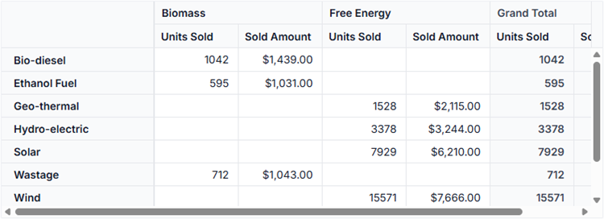

You can also use JSON data from a remote server in the same way as a local JSON file. Both directly downloadable *.json files and web service URLs are supported. To do this, specify the URL of the remote *.json file in the **GetData** method. The remaining configurations stay the same.

In the server-side application, the CDN link is used to connect the same **sales-analysis.json** file which is already hosted in the Syncfusion<sup style="font-size:70%">&reg;</sup> server.

```csharp
public async Task<object> GetData(FetchData param)
{
    return await _cache.GetOrCreateAsync("dataSource" + param.Hash,
    async (cacheEntry) =>
    {
        cacheEntry.SetSize(1);
        cacheEntry.AbsoluteExpiration = DateTimeOffset.UtcNow.AddMinutes(60);

        // Here bind JSON type data source from remote server.
        return new DataSource.PivotJSONData().ReadJSONData("http://cdn.syncfusion.com/data/sales-analysis.json");
    });
}
```

#### CSV

The server-side Pivot Engine supports CSV data from a local *.csv file or a remote server. To use a local CSV file, read the file using the **StreamReader** class, which converts the file content into a string. This string is then split into a collection that can be bound to the server-side Pivot Engine. In the Pivot Table, set the [`type`](https://ej2.syncfusion.com/documentation/api/pivotview/fieldoptionsmodel#type) property in the [`dataSourceSettings`](https://ej2.syncfusion.com/documentation/api/pivotview/datasourcesettings) to **CSV**.

In the server application, the **sales.csv** file is located in the **DataSource** folder, and its data model is defined in the **DataSource.cs** file as shown below:

```csharp
public class PivotCSVData
{
    public string Region { get; set; }
    public string Country { get; set; }
    public string ItemType { get; set; }
    public string SalesChannel { get; set; }
    public string OrderPriority { get; set; }
    public string OrderDate { get; set; }
    public int OrderID { get; set; }
    public string ShipDate { get; set; }
    public int UnitsSold { get; set; }
    public double UnitPrice { get; set; }
    public double UnitCost { get; set; }
    public double TotalRevenue { get; set; }
    public double TotalCost { get; set; }
    public double TotalProfit { get; set; }


    public List<string[]> ReadCSVData(string url)
    {
        List<string[]> data = new List<string[]>();
        using (StreamReader reader = new StreamReader(new WebClient().OpenRead(url)))
        {
            string line;
            while ((line = reader.ReadLine()) != null)
            {
                line = line.Trim();
                if (!string.IsNullOrWhiteSpace(line))
                {
                    data.Add(line.Split(','));
                }
            }
            return data;
        }
    }
}
```

To bind the CSV data, set the **PivotCSVData** model as the **TValue** type for the **PivotEngine** class:

```csharp
private PivotEngine<DataSource.PivotCSVData> PivotEngine = new PivotEngine<DataSource. PivotCSVData>();
```

Next, retrieve the CSV data in the **GetData** method of the **PivotController.cs** file:

```csharp
public async Task<object> GetData(FetchData param)
{
    return await _cache.GetOrCreateAsync("dataSource" + param.Hash,
        async (cacheEntry) =>
        {
            cacheEntry.SetSize(1);
            cacheEntry.AbsoluteExpiration = DateTimeOffset.UtcNow.AddMinutes(60);

            // Here bind CSV type data source from sales.csv file.
            return new DataSource.PivotCSVData().ReadCSVData(_hostingEnvironment.ContentRootPath + "//DataSource//sales.csv");
        });
}
```

Finally, configure the Pivot Table with the appropriate report settings based on the CSV data source:

```ts
let pivotObj: PivotView = new PivotView({
    dataSourceSettings: {
        url: 'https://localhost:44350/api/pivot/post',
        mode: 'Server',
        type: 'CSV',
        rows: [{
            name: 'ItemType', caption: 'Item Type'
        }],
        formatSettings: [{
            name: 'UnitPrice', format: 'C'
        }],
        columns: [{
            name: 'Region'
        }],
        values: [
            { name: 'UnitsSold', caption: 'Units Sold' },
            { name: 'UnitPrice', caption: 'Sold Amount' }
        ],
    },
    //Other codes here...
});

```

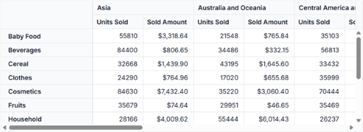

You can also use CSV data from a remote server, such as a downloadable file or a web service URL. To do this, provide the CSV file URL in the **GetData** method. The process for setting up the Pivot Table remains the same as described above.

Here is an example of using a remote CSV file hosted on the Syncfusion server:

```csharp
public async Task<object> GetData(FetchData param)
{
    return await _cache.GetOrCreateAsync("dataSource" + param.Hash,
        async (cacheEntry) =>
        {
            cacheEntry.SetSize(1);
            cacheEntry.AbsoluteExpiration = DateTimeOffset.UtcNow.AddMinutes(60);

            // Here bind CSV type data source from remote server.
            return new DataSource.PivotCSVData().ReadCSVData("http://cdn.syncfusion.com/data/sales-analysis.csv");
        });
}
```

#### DataTable

In a server-side application, you can create a DataTable named **BusinessObjectsDataView** by mapping it to the **PivotViewData** model type defined in the **DataSource.cs** file. The following code demonstrates how to generate this DataTable from a collection of `PivotViewData` objects:

```csharp
public class BusinessObjectsDataView
{
    public DataTable GetDataTable()
    {
        DataTable dt = new DataTable("BusinessObjectsDataTable");
        PropertyDescriptorCollection pdc = TypeDescriptor.GetProperties(typeof(PivotViewData));
        foreach (PropertyDescriptor pd in pdc)
        {
            dt.Columns.Add(new DataColumn(pd.Name, pd.PropertyType));
        }
        List<PivotViewData> list = new PivotViewData().GetVirtualData();
        foreach (PivotViewData bo in list)
        {
            DataRow dr = dt.NewRow();
            foreach (PropertyDescriptor pd in pdc)
            {
                dr[pd.Name] = pd.GetValue(bo);
            }
            dt.Rows.Add(dr);
        }
        return dt;
    }
}
```

To bind the data source, set the model type **PivotViewData** to the **TValue** property of the **PivotEngine** class, as shown below:

```csharp
private PivotEngine<DataSource.PivotViewData> PivotEngine = new PivotEngine<DataSource.PivotViewData>();
```

Next, retrieve the data source by calling the **GetData** method in the **PivotController.cs** file. This method uses caching to improve performance:

```csharp
public async Task<object> GetData(FetchData param)
{
    return await _cache.GetOrCreateAsync("dataSource" + param.Hash,
        async (cacheEntry) =>
        {
            cacheEntry.SetSize(1);
            cacheEntry.AbsoluteExpiration = DateTimeOffset.UtcNow.AddMinutes(60);

            // Here bind the DataTable.
            return new DataSource.BusinessObjectsDataView().GetDataTable();
        });
}
```

Finally, configure the Pivot Table by setting the appropriate report using the [dataSourceSettings](https://ej2.syncfusion.com/documentation/api/pivotview/index-default#datasourcesettings) property. Below is an example configuration that connects to the server-side data source:

```ts
let pivotObj: PivotView = new PivotView({
    dataSourceSettings: {
        url: 'https://localhost:44350/api/pivot/post',
        mode: 'Server',
        rows: [{
            name: 'ProductID', caption: 'Product ID'
        }],
        formatSettings: [{
            name: 'Price', format: 'C'
        }],
        columns: [{
            name: 'Year', caption: 'Production Year'
        }],
        values: [
            { name: 'Sold', caption: 'Units Sold' },
            { name: 'Price', caption: 'Sold Amount' }
        ],
    }
    //Other codes here...
});

```


#### Dynamic

Usually, the model type must be defined for most data sources in the server-side pivot engine. However, when using certain data sources, such as dynamic types, it is not necessary to define a model type. The server-side pivot engine supports these data sources as well.

##### ExpandoObject

In a server-side application, users can use an **ExpandoObject** as a data source. This type of data source is managed by the `PivotExpandoData` class found in the **DataSource.cs** file. The following code shows how to create a list of **ExpandoObject** items:

```csharp
public class PivotExpandoData
{
    public List<ExpandoObject> Orders { get; set; } = new List<ExpandoObject>();
    public List<ExpandoObject> GetExpandoData()
    {
        Orders = Enumerable.Range(1, 75).Select((x) =>
        {
            dynamic d = new ExpandoObject();
            d.OrderID = 1000 + (x % 100);
            d.CustomerID = (new string[] { "ALFKI", "ANANTR", "ANTON", "BLONP", "BOLID" })[new Random().Next(5)];
            d.Freight = (new double[] { 2, 1, 4, 5, 3 })[new Random().Next(5)] * x;
            d.OrderDate = (new DateTime[] { new DateTime(2010, 11, 5), new DateTime(2018, 10, 3), new DateTime(1995, 9, 9), new DateTime(2012, 8, 2), new DateTime(2015, 4, 11) })[new Random().Next(5)];
            d.ShipCountry = (new string[] { "USA", "UK" })[new Random().Next(2)];
            d.Verified = (new bool[] { true, false })[new Random().Next(2)];

            return d;
        }).Cast<ExpandoObject>().ToList<ExpandoObject>();
        return Orders;
    }
}
```

To use this data source with the server-side pivot engine, specify **ExpandoObject** as the model type for `TValue` in the `PivotEngine` class:

```csharp
private PivotEngine<ExpandoObject> PivotEngine = new PivotEngine<ExpandoObject>();
```

Next, in the **GetData** method of the **PivotController.cs** file, return the ExpandoObject data source:

```csharp
public async Task<object> GetData(FetchData param)
{
    return await _cache.GetOrCreateAsync("dataSource" + param.Hash,
        async (cacheEntry) =>
        {
            cacheEntry.SetSize(1);
            cacheEntry.AbsoluteExpiration = DateTimeOffset.UtcNow.AddMinutes(60);

            // Here returns ExpandoObject type data source.
            return new DataSource.PivotExpandoData().GetExpandoData();
        });
}
```

Finally, configure the [dataSourceSettings](https://ej2.syncfusion.com/documentation/api/pivotview/index-default#datasourcesettings) property for the Pivot Table on the client side. Set the appropriate fields for rows, columns, and values to match the ExpandoObject properties:

```ts
let pivotObj: PivotView = new PivotView({
    dataSourceSettings: {
        url: 'https://localhost:44350/api/pivot/post',
        mode: 'Server',
        rows: [{
            name: 'CustomerID', caption: 'Customer ID'
        }],
        columns: [{
            name: 'ShipCountry', caption: 'Ship Country'
        }],
        values: [
            { name: 'Freight', caption: 'Units Sold' }
        ]
    }
    //Others codes here...
});

```

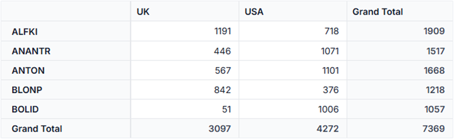

##### Dynamic Objects

A dynamic object allows users to bind data to the [Pivot Table](https://ej2.syncfusion.com/documentation/api/pivotview/index-default) without having to define a fixed model type. In a server-side application, a data source is created using dynamic objects which are available under the **PivotDynamicData** class in the **DataSource.cs** file.

```csharp
public class PivotDynamicData
{
    public List<DynamicDictionary> Orders = new List<DynamicDictionary>() { };
    public List<DynamicDictionary> GetDynamicData()
    {
        Orders = Enumerable.Range(1, 100).Select((x) =>
        {
            dynamic d = new DynamicDictionary();
            d.OrderID = 100 + x;
            d.CustomerID = (new string[] { "ALFKI", "ANANTR", "ANTON", "BLONP", "BOLID" })[new Random().Next(5)];
            d.Freight = (new double[] { 2, 1, 4, 5, 3 })[new Random().Next(5)] * x;
            d.OrderDate = (new DateTime[] { new DateTime(2010, 11, 5), new DateTime(2018, 10, 3), new DateTime(1995, 9, 9), new DateTime(2012, 8, 2), new DateTime(2015, 4, 11) })[new Random().Next(5)];
            d.ShipCountry = (new string[] { "USA", "UK" })[new Random().Next(2)];
            d.Verified = (new bool[] { true, false })[new Random().Next(2)];
            return d;
        }).Cast<DynamicDictionary>().ToList<DynamicDictionary>();
        return Orders;
    }

    public class DynamicDictionary : System.Dynamic.DynamicObject
    {
        Dictionary<string, object> dictionary = new Dictionary<string, object>();
        public override bool TryGetMember(GetMemberBinder binder, out object result)
        {
            string name = binder.Name;
            return dictionary.TryGetValue(name, out result);
        }
        public override bool TrySetMember(SetMemberBinder binder, object value)
        {
            dictionary[binder.Name] = value;
            return true;
        }
        //The "GetDynamicMemberNames" method of the "DynamicDictionary" class must be overridden and return the property names to perform data operation and editing while using dynamic objects.
        public override System.Collections.Generic.IEnumerable<string> GetDynamicMemberNames()
        {
            return this.dictionary?.Keys;
        }
    }
}
```

To use this data source in the server-side code, assign the **PivotDynamicData** class to the **TValue** of the `PivotEngine` class:

```csharp
private PivotEngine<DataSource.PivotDynamicData> PivotEngine = new PivotEngine<DataSource.PivotDynamicData>();
```

When loading data in the **GetData** method of the **PivotController.cs** file, return the dynamic data source as shown below:

```csharp
public async Task<object> GetData(FetchData param)
{
    return await _cache.GetOrCreateAsync("dataSource" + param.Hash,
        async (cacheEntry) =>
        {
            cacheEntry.SetSize(1);
            cacheEntry.AbsoluteExpiration = DateTimeOffset.UtcNow.AddMinutes(60);

            // Here bind data source with dynamic objects.
            return new DataSource.PivotDynamicData().GetDynamicData();
        });
}
```

Finally, configure the [dataSourceSettings](https://ej2.syncfusion.com/documentation/api/pivotview/index-default#datasourcesettings) property for the Pivot Table on the client side.

```ts
let pivotObj: PivotView = new PivotView({
    dataSourceSettings: {
        url: 'https://localhost:44350/api/pivot/post',
        mode: 'Server',
        rows: [{
            name: 'CustomerID', caption: 'Customer ID'
        }],
        columns: [{
            name: 'ShipCountry', caption: 'Ship Country'
        }],
        values: [
            { name: 'Freight', caption: 'Units Sold' }
        ]
    }
    //Other codes here...
});

```

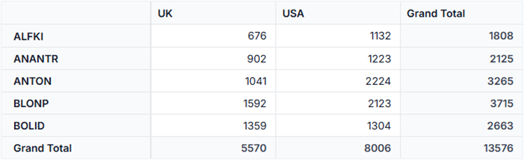

### Advanced Server Configuration

The Advanced Server Configuration is an optional backend configuration layer in the ASP.NET Core **PivotController** application. It lets you register one or more file-based or database-based data sources as indexes, and control how the server loads, caches, secures, and serves them. Configure it in **PivotController/appsettings.json** or by using the configuration and index APIs of the controller. The Pivot Table continues to use server mode and the `/api/pivot/post` endpoint; it does not connect directly to the configured data source.

You can download the ASP.NET Core standalone Pivot Table [application](https://github.com/SyncfusionExamples/syncfusion-pivot-table-advanced-server-configuration) from GitHub. This repository provides the primary reference for configuring JSON, CSV, PostgreSQL, and other supported database data sources.

#### Architecture and request flow

1. The Pivot Table posts its report definition and the requested action to `/api/pivot/post`.
2. The controller selects the index from the `index` value in the request body, the `index` query-string parameter, or `DataServer:DefaultIndexId`, in that order.
3. `IndexManager` loads the selected index from its configured JSON file, CSV file, or database. It also maintains the index status and the server-side data and engine-response caches.
4. For JSON and CSV indexes, the controller applies the configured field type mappings, and then passes the report and the indexed data to the server-side Pivot Engine.
5. The controller returns the Pivot Engine response to the Pivot Table. The response contains the processed result, not the complete source data.
6. When the application starts, it reads the following sections of **appsettings.json**:
   - `DataServer`
   - `General`
   - `DataStorage`
   - `DatabaseQuery`
   - `Https`
   - `Security`
   - `ReportSharingOptions`

#### Configure an index

An index tells the controller which data source to load for the Pivot Table. Add the data source details to `DataServer:Indexes` in **appsettings.json**. All enabled indexes are loaded when the application starts.

##### Configure a JSON index

```json
{
  "DataServer": {
    "DefaultIndexId": "Sales-Json",
    "Indexes": [
      {
        "Index": "Sales-Json",
        "Name": "Sales analysis",
        "SourceType": "Json",
        "SourcePath": "sales-analysis.json",
        "Enabled": true,
        "AutoReload": true,
        "ReloadIntervalMinutes": 20,
        "MappingEnabled": false,
        "FieldMappings": []
      }
    ]
  }
}
```

The JSON file must contain an array of objects, with each object representing one record. A relative `SourcePath` is resolved against the folder set in `General:DataFolder`. In the sample application, this is **PivotController/DataSource**.

Each index name must be unique, ignoring uppercase and lowercase differences. An index name can contain up to 64 characters, and only letters, numbers, periods (`.`), underscores (`_`), and hyphens (`-`).

##### Common index properties

These properties apply to all supported source types:

| Property | Purpose and behavior |
|---|---|
| `DefaultIndexId` | The index used to process a request when the request does not specify an index. Set it to the identifier of an enabled index. Otherwise, requests without an index return HTTP 404 (not found) or HTTP 423 (disabled). This property is set once under `DataServer`, not for each index. |
| `Indexes` | Collection of data source index definitions. |
| `Index` | Unique identifier used by Pivot Table requests and the index management APIs. |
| `Name` | A readable label that helps you recognize the index. It does not select the data source. |
| `SourceType` | Identifies the data source. Use `Json` for JSON files, `Csv` for CSV files, or `Database` for a database. For a database index, use `DatabaseType` to choose the database. |
| `SourcePath` | File path of a JSON or CSV source. Required for these source types. |
| `Enabled` | Controls whether the index can serve requests. A disabled index returns HTTP 423 when requested. **Default:** `true`. |
| `AutoReload` | Set to `true` to reload the data source automatically at the interval set in `ReloadIntervalMinutes`. **Default:** `false`. |
| `ReloadIntervalMinutes` | Time, in minutes, between scheduled reloads. Must be greater than `0` when `AutoReload` is `true`. |
| `MappingEnabled` | Applies to JSON and CSV indexes. Field types are detected automatically by default. Set to `true` to use the types defined in `FieldMappings`. |
| `FieldMappings` | Optional field names and data types for JSON and CSV indexes. See [Field Mapping](#field-mapping). |

##### Configure a CSV index

For a CSV index, set `SourceType` to `Csv`. The CSV file must contain a header row. Set the parsing options to match the file. Add an object like the following to the `Indexes` array:

```json
{
  "Index": "Data-Csv",
  "Name": "Data CSV",
  "SourceType": "Csv",
  "SourcePath": "data.csv",
  "CsvDelimiter": ";",
  "CsvDecimalSeparator": "Comma",
  "CsvThousandsSeparator": "Dot",
  "AutoReload": false,
  "ReloadIntervalMinutes": 1,
  "Enabled": true
}
```

| CSV property | Purpose and accepted values |
|---|---|
| `CsvDelimiter` | Character between columns, such as `,`, `;`, or a vertical bar. **Default:** `,`. |
| `CsvDecimalSeparator` | Decimal character. Use `Dot` (or `.`) or `Comma` (or `,`). **Default:** `Dot`. |
| `CsvThousandsSeparator` | Digit grouping character. Use `Comma` (or `,`), `Dot` (or `.`), or `Space` (or a space character). **Default:** `Comma`. |

##### Configure a database index

To connect a database, add its index definition to the `DataServer:Indexes` array. Set `SourceType` to `Database`, choose the database with `DatabaseType`, and provide the connection details and a read-only query. The `DatabaseType` values are as follows:

| Database | `DatabaseType` value |
|---|---|
| MySQL | `MySql` |
| MariaDB | `MariaDB` |
| Microsoft SQL Server | `MSSQL` |
| PostgreSQL | `PostgreSQL` |
| Oracle | `Oracle` |
| SQLite | `Sqlite` |

> The sample controller includes providers for PostgreSQL and SQLite only. The other database types are valid configuration values, but they need a provider package and implementation to be registered before they can connect. Without one, the connection test returns HTTP 501.

The following example adds a PostgreSQL index. Replace the connection string placeholders with values for your database:

```json
{
  "Index": "Sales-Db",
  "Name": "PostgreSQL sales database",
  "SourceType": "Database",
  "DatabaseType": "PostgreSQL",
  "ConnectionString": "Host=localhost;Port=5432;Database=salesdb;Username=YOUR_USER;Password=YOUR_PASSWORD",
  "Query": "SELECT * FROM salesdata",
  "ReloadIntervalMinutes": 1,
  "AutoReload": false,
  "Enabled": true
}
```

| Property | Purpose and behavior |
|---|---|
| `SourceType` | Set to `Database` for every database index. |
| `DatabaseType` | Selects the database provider. Required for database indexes. |
| `ConnectionString` | Connection details for the database. If both `ConnectionString` and `ConnectionStringName` are set, `ConnectionString` takes precedence. Keep real credentials out of source control. |
| `ConnectionStringName` | Name of a connection string in the top-level `ConnectionStrings` section of **appsettings.json**. Use it instead of placing the connection string in the index. Either `ConnectionString` or `ConnectionStringName` is required. |
| `Query` | A single read-only query that selects the data to load. It must start with `SELECT` or `WITH`. The controller rejects queries that contain a semicolon or the keywords `INSERT`, `UPDATE`, `DELETE`, `MERGE`, `CREATE`, `ALTER`, `DROP`, `GRANT`, `TRUNCATE`, or `REPLACE`. |

Connection string rules vary by database provider. If a password contains special characters, follow the rules of the selected provider and test the connection.

To test a database index without loading its data, call `POST /api/indexes/{index}/test-connection`. To test settings before creating an index, call `POST /api/indexes/test-connection` with `databaseType`, `connectionString` (or `connectionStringName`), and `query` in the request body.

#### Field Mapping

Field type mapping is supported only for JSON and CSV indexes. The controller detects field types when it loads a source. If a detected type is not appropriate for Pivot Table operations, set the following properties in the index definition:

```json
{
  "MappingEnabled": true,
  "FieldMappings": [
    { "FieldName": "ProCost", "Type": "Number" },
    { "FieldName": "Date", "Type": "Date" },
    { "FieldName": "Sector", "Type": "String" }
  ]
}
```

The supported mapping types are `Number`, `Date`, and `String`. Each `FieldName` must exist in the JSON or CSV source. The controller applies the mappings to every Pivot Table request for the index, so they affect operations such as aggregation, sorting, and grouping. The Pivot Table does not need to repeat the mappings.

Use the following APIs to inspect and change mappings:

| Endpoint | Purpose |
|---|---|
| `GET /api/indexes/{index}/fields` | Lists each field with its detected, mapped, and effective type. |
| `PUT /api/indexes/{index}/fields/{fieldName}` | Sets the type of one field. The request body is `{ "type": "Number" }`, `{ "type": "String" }`, or `{ "type": "Date" }`. |
| `DELETE /api/indexes/{index}/fields/{fieldName}` | Removes the mapping so the field uses its detected type. |

#### Connect the Pivot Table and verify the index

1. Save the settings and start the **PivotController** application. The controller loads the enabled indexes at startup.
2. Call `GET /api/indexes`. The response reports each index's status (`Ready`, `Refreshing`, `Failed`, or `Disabled`), row count, load time, and last error. Resolve a `Failed` status before connecting the Pivot Table.
3. Point the Pivot Table to the server endpoint. In this example, `DataServer:DefaultIndexId` is `Sales-Json`, which loads **sales-analysis.json**. Because the request does not specify another index, the controller uses `Sales-Json`. Set the report fields to names that exist in that file. For example, use `Sector` in the [`rows`](https://ej2.syncfusion.com/documentation/api/pivotview/datasourcesettingsmodel#rows) axis, `EnerType` in the [`columns`](https://ej2.syncfusion.com/documentation/api/pivotview/datasourcesettingsmodel#columns) axis, and `PowUnits` and `ProCost` in the [`values`](https://ej2.syncfusion.com/documentation/api/pivotview/datasourcesettingsmodel#values) axis of [`dataSourceSettings`](https://ej2.syncfusion.com/documentation/api/pivotview/datasourcesettings):

```ts
import { PivotView } from '@syncfusion/ej2-pivotview';

let pivotObj: PivotView = new PivotView({
    dataSourceSettings: {
        url: 'http://localhost:6885/api/pivot/post',
        mode: 'Server',
        rows: [{ name: 'Sector' }],
        columns: [{ name: 'EnerType', caption: 'Energy Type' }],
        values: [
            { name: 'PowUnits', caption: 'Power Units' },
            { name: 'ProCost', caption: 'Production Cost' }
        ]
    }
});
pivotObj.appendTo('#PivotTable');
```

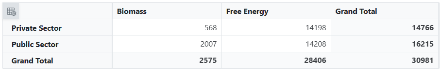

> The URL uses the port set in `General:Port` (`6885` in the sample). If you enable HTTPS, use `https://` in the URL. If you change the port, update the URL.

To select a different configured index, add its identifier to the endpoint URL, for example `http://localhost:6885/api/pivot/post?index=Data-Csv`. Use field names that exist in that index for [`rows`](https://ej2.syncfusion.com/documentation/api/pivotview/datasourcesettingsmodel#rows), [`columns`](https://ej2.syncfusion.com/documentation/api/pivotview/datasourcesettingsmodel#columns), [`values`](https://ej2.syncfusion.com/documentation/api/pivotview/datasourcesettingsmodel#values), and filters. If the Pivot Table is hosted on a different origin, add that origin to `Security:CORS:AllowOrigin`. An unknown index returns HTTP 404 with the list of valid index identifiers.

#### Manage indexes

Use the following APIs to manage indexes at runtime. Index changes made through these APIs are persisted in **indexes.json** in the `General:DataFolder` folder.

| Endpoint | Purpose |
|---|---|
| `GET /api/indexes` | Lists all indexes with their status. |
| `GET /api/indexes/{index}` | Returns the status of one index. |
| `POST /api/indexes` | Creates an index from an index definition in the request body. Returns HTTP 409 if the index already exists. |
| `PUT /api/indexes/{index}` | Edits an index. Only the properties in the request body are changed. |
| `POST /api/indexes/{index}/reload` | Reloads the data source immediately. |
| `POST /api/indexes/{index}/enable` | Enables the index and loads its data. |
| `POST /api/indexes/{index}/disable` | Disables the index. Requests for it return HTTP 423. |
| `DELETE /api/indexes/{index}` | Deletes the index and its cached data. |

#### Data Server Settings

The following settings control how the server runs and handles data. Configure them in the matching section at the root of **PivotController/appsettings.json**.

##### General Settings

The `General` section controls the server port, log messages, and data folder. For example:

```json
{
  "General": {
    "Port": 6885,
    "MinimumLogLevel": "Info",
    "DataFolder": "DataSource"
  }
}
```

| Setting | What it does |
|---|---|
| `Port` | Port the server listens on. Use a value from `1` to `65535`. If you change the port, restart the server and update the port in the Pivot Table endpoint URL. |
| `MinimumLogLevel` | Sets which server messages are written to the log. Choose `Info`, `Warn`, `Error`, or `Fatal`. A higher level writes fewer messages. A change made through the configuration API takes effect immediately. |
| `DataFolder` | Folder used for data files and saved server settings. A relative path is based on the application folder, and the path must stay inside it. Changing it requires a restart. |

The sample uses `DataFolder: "DataSource"`, so its data files are stored in **PivotController/DataSource**. You can read or update these settings with `GET` and `PUT /api/config/general`. A `PUT` request can include only the settings to change. Changes to the port and data folder need a restart; the log level does not.

##### DataStorage Settings

These settings control index loading, refresh behavior, and server-side caching:

| Setting | What it does |
|---|---|
| `RetryAttempts` | Number of times the server retries after the first failed attempt to load an index. Set to `0` to disable retries. Valid values are `0` to `30`. **Default:** `3`. |
| `CacheSizeLimit` | Maximum number of cached server responses for each index. When the limit is reached, the least recently used response is removed first. Set to `0` to disable caching. Changing it requires a restart. **Default:** `100`. |

`RetryAttempts` takes effect immediately when changed through `PUT /api/config/datastorage`. To see which indexes are currently cached, call `GET /api/config/datastorage/cache-stats`.

##### DatabaseQuery Settings

These settings control how long the Data Server waits for a database query. They apply only to indexes that use the `Database` source type.

| Setting | What it does |
|---|---|
| `CommandTimeoutEnabled` | Enables the Data Server query time limit. When `false`, the timeout of the database driver is used. **Default:** `false`. |
| `CommandTimeLimit` | Maximum time, in seconds, that the Data Server waits for a query when `CommandTimeoutEnabled` is `true`. When the limit is reached, the query is canceled and the index load reports an error. Set to `0` for no limit. Negative values are not allowed. **Default:** `150`. |

For example:

```json
{
  "DatabaseQuery": {
    "CommandTimeoutEnabled": true,
    "CommandTimeLimit": 150
  }
}
```

Changes made through `GET` or `PUT /api/config/databasequery` take effect on the next database query.

##### HTTPS Settings

The `Https` section controls whether the server accepts HTTPS connections and which certificate it uses. HTTPS is disabled by default. To enable it, set `Enabled` to `true` and configure exactly one certificate source: a PFX file, a PEM certificate and key pair, or a certificate from a certificate store. There is no separate certificate type property. The type is determined by the properties you set, so leave the other source properties empty.

For example, this configuration uses a PFX certificate:

```json
{
  "Https": {
    "Enabled": true,
    "PfxPath": "certificates/server.pfx",
    "PfxPassword": "SET_A_SECRET",
    "PemCertPath": null,
    "PemKeyPath": null,
    "StoreLocation": "CurrentUser",
    "StoreName": "My",
    "Thumbprint": null,
    "SubjectName": null,
    "Protocols": "HTTP1_AND_HTTP2"
  }
}
```

| Setting | What it does |
|---|---|
| `Enabled` | Enables or disables HTTPS. **Default:** `false`. |
| `PfxPath` | Path to the `.pfx` certificate file. |
| `PfxPassword` | Password of the PFX file, if it requires one. Keep it secret. The HTTPS settings API does not return or save it. |
| `PemCertPath` | Path to the PEM certificate file. Set it together with `PemKeyPath`. |
| `PemKeyPath` | Path to the PEM file that contains the private key of the certificate. |
| `Thumbprint` | Thumbprint used to find a certificate in the certificate store. Use either this or `SubjectName`. |
| `SubjectName` | Subject name used to find a certificate in the certificate store, for example `CN=localhost`. Use either this or `Thumbprint`. |
| `StoreLocation` | Certificate store location: `CurrentUser` or `LocalMachine`. **Default:** `CurrentUser`. |
| `StoreName` | Name of the certificate store to search. **Default:** `My`. |
| `Protocols` | Protocols accepted by the server: `HTTP1`, `HTTP2`, or `HTTP1_AND_HTTP2`. **Default:** `HTTP1_AND_HTTP2`. |

For a PEM certificate, set `PemCertPath` and `PemKeyPath`. For a certificate store, set `Thumbprint` or `SubjectName`. Do not configure more than one certificate source.

The certificate must be accessible to the server and include its private key. If the certificate cannot be used, the server starts with HTTP only and writes the reason to the console. Changes to the HTTPS settings require a restart. After enabling HTTPS, use `https://` and the configured port in the Pivot Table endpoint URL, and make sure the client trusts the certificate. You can read or update these settings with `GET` and `PUT /api/config/https`.

##### Security Settings

Use the `Security` section to protect API requests and to choose which websites can call the Data Server from a browser:

```json
{
  "Security": {
    "Authorization": {
      "Enabled": true,
      "Username": "YOUR_SERVER_USER",
      "Password": "SET_A_SECRET"
    },
    "CORS": {
      "AllowOrigin": "https://pivot.example.com"
    }
  }
}
```

| Setting | What it does |
|---|---|
| `Authorization:Enabled` | Turns Basic Authentication on or off. When on, every request to an `/api` endpoint must include the configured username and password. **Default:** `false`. |
| `Authorization:Username` / `Authorization:Password` | The credentials that the server checks. Required when authorization is enabled. Keep real credentials out of client-side code and source control. |
| `CORS:AllowOrigin` | Website origins that browsers can use to send requests to the Data Server. Use `*` to allow any origin when Basic Authentication is off. When it is on, list specific origins separated by commas. `*` is not allowed with Basic Authentication, and the server does not start with an invalid combination. **Default:** `*`. |

Enter each origin with its `http://` or `https://` scheme and host. Include the port if the website uses one, and do not include a page path. For example, use `https://pivot.example.com`, not `https://pivot.example.com/dashboard`.

When `Authorization:Enabled` is `true`, each request must include an `Authorization` header that uses the `Basic` scheme. To add the header to Pivot Table requests, use the [`beforeServiceInvoke`](https://ej2.syncfusion.com/documentation/api/pivotview/beforeserviceinvokeeventargs) event as described in [Secure server requests with beforeServiceInvoke](#secure-server-requests-with-beforeserviceinvoke). That section uses a Bearer token example. The Data Server does not accept Bearer tokens, so use the `Basic` scheme instead:

```ts
beforeServiceInvoke: function (args: any) {
    const credentials: string = getServerCredentials(); // "username:password", obtained securely at runtime
    args.internalProperties = args.internalProperties || {};
    args.internalProperties.headers = {
        ...(args.internalProperties.headers || {}),
        'Authorization': `Basic ${btoa(credentials)}`
    };
}
```

Do not hard-code server credentials in client-side code. Use HTTPS and a protected sign-in flow or a server-side proxy.

You can read or update the authorization state and the allowed origins with `GET` and `PUT /api/config/security`. The username and password are configured only in the server settings, and the API never returns the password.

##### Report Sharing Settings

Report sharing lets applications save and retrieve Pivot Table reports through the Data Server. It is disabled by default. Configure it in the `ReportSharingOptions` section:

```json
{
  "ReportSharingOptions": {
    "EndpointEnabled": false,
    "PathToFolder": "DataServer/reports",
    "ReportExpirationTime": 0,
    "MaxSizeOfFolder": 0,
    "AutoDeletingEnabled": false
  }
}
```

| Setting | What it does |
|---|---|
| `EndpointEnabled` | Turns the report sharing endpoints on or off. When on, the server also saves the report settings sent with Pivot Table requests. When off, report sharing requests return HTTP 404. **Default:** `false`. |
| `PathToFolder` | Folder where report files are saved. A relative path is based on `General:DataFolder`. An absolute path can also be used. Paths that contain `..` are rejected. With the sample `DataFolder` value of `DataSource`, the default resolves to **PivotController/DataSource/DataServer/reports**. Changing it requires a restart. **Default:** `DataServer/reports`. |
| `ReportExpirationTime` | Number of minutes that reports are kept. Set to `0` to keep reports permanently. **Default:** `0`. |
| `MaxSizeOfFolder` | Maximum total size of the report folder, in MB. Set to `0` for no limit. **Default:** `0`. |
| `AutoDeletingEnabled` | Controls what happens when saving a report would exceed `MaxSizeOfFolder`. When `true`, the server deletes the oldest reports until there is room. If the new report still does not fit, it is not saved. When `false`, the new report is not saved. This setting does not affect expiration cleanup. **Default:** `false`. |

When `EndpointEnabled` is `true`, the server saves the report configuration sent to `POST /api/pivot/post` automatically. The Pivot Table does not need to send a separate save request. Applications can use the following endpoints to manage saved reports:

| Endpoint | Purpose |
|---|---|
| `POST /api/reportsharing/reports` | Saves a report. |
| `GET /api/reportsharing/reports` | Lists saved reports. |
| `GET /api/reportsharing/reports/{reportId}` | Retrieves a saved report. |
| `DELETE /api/reportsharing/reports/{reportId}` | Deletes a saved report. |

If `ReportExpirationTime` is greater than `0`, expired reports are removed automatically, regardless of `AutoDeletingEnabled`.

##### Update Settings and Persistence

Use the following endpoints to read or update the settings. A `PUT` request can include only the properties to change:

| Endpoint | Settings |
|---|---|
| `GET/PUT /api/config/general` | Port, log level, and data folder. |
| `GET/PUT /api/config/datastorage` | Retry, cache, and data retention settings. |
| `GET/PUT /api/config/databasequery` | Database query timeout settings. |
| `GET/PUT /api/config/security` | Authorization enabled state and allowed origins. Credentials are configured in the server settings, not through this API. |
| `GET/PUT /api/config/https` | HTTPS listener and certificate settings. |
| `GET/PUT /api/config/reportsharing` | Report sharing settings. |

Changes made through these APIs are saved as JSON files in the `General:DataFolder` folder, for example **security.json**, **https.json**, and **reportsharing.json**. When such a file exists, its values override the matching values in **appsettings.json** at the next startup. Delete the file to configure the section from **appsettings.json** only.

### Controller Configuration

#### Memory Cache

In a server-side application, the [`Memory Cache`](https://docs.microsoft.com/en-us/dotnet/api/system.runtime.caching.memorycache?view=dotnet-plat-ext-5.0) option helps store the data source and engine properties in RAM for use during UI actions in the Pivot Table. This approach improves performance by preventing the need to recalculate aggregated values every time the user interacts with the Pivot Table. The following example shows how the memory cache is used in the **GetEngine** method to store engine properties:

```csharp
public async Task<EngineProperties> GetEngine(FetchData param)
{
    isRendered = false;
    // Engine properties are stored in memory cache with GUID "parem.Hash".
    return await _cache.GetOrCreateAsync("engine" + param.Hash,
        async (cacheEntry) =>
        {
            isRendered = true;
            cacheEntry.SetSize(1);
            // Memory cache expiration time can be set here.
            cacheEntry.AbsoluteExpiration = DateTimeOffset.UtcNow.AddMinutes(60);
            PivotEngine.Data = await GetData(param);
            return await PivotEngine.GetEngine(param);
        });
}
```

Engine properties are saved in RAM using a unique ID (GUID) that is received from the client-side source code. This GUID is randomly generated and changes if the user refreshes the page or opens the Pivot Table in a new browser tab or window. Because of this, each GUID in the memory cache holds information unique to that session, allowing each Pivot Table instance to work independently.

The memory cache is configured to expire after 60 minutes to help free up RAM. If the user is still working with the Pivot Table after this period, the required data will be generated and cached for another 60 minutes.

#### Methods and its needs

- **Post:** This method receives requests from the client side of the Pivot Table and forwards them to the appropriate server-side method for processing.
- **GetEngine:** Stores engine properties in RAM as a cache. This method is triggered during the initial rendering of the Pivot Table or when the memory cache expires.
- **GetData:** This method stores the Pivot Table’s data source in a cache on the server. Like **GetEngine**, it is triggered on the first load or after the memory cache is cleared. This enables faster retrieval of the Pivot Table’s data and allows the table to respond quickly to changes.
- **GetMembers:** Allows retrieval of the members of a field. This method is triggered when the member editor is opened for a filtering operation.
- **GetRawData:** Fetches the raw, unaggregated data behind a value cell. This method is used when the user opens the drill-through dialog or starts editing a value in the Pivot Table.
- **GetPivotValues:** Updates the stored engine properties in the in-memory cache and returns the aggregated values to the browser to render the Pivot Table. The return value can be modified, and the Pivot Table will be rendered in the browser based on this.

## Excel Export

The server-side engine seamlessly supports Excel export functionality, enabling users to efficiently generate and download pivot table reports in Excel format directly from the server. To enable Excel export in the pivot table, set the [`allowExcelExport`](https://ej2.syncfusion.com/documentation/api/pivotview/index-default#allowexcelexport) as **true**. Once the API is set, the user needs to call the  [`excelExport`](https://ej2.syncfusion.com/documentation/api/pivotview/index-default#excelexport) method to export the pivot table to Excel by clicking an external button.

> The pivot table component can be exported to Excel format using options available in the toolbar. For more details [refer](./tool-bar) here.

```ts
let pivotTableObj: PivotView = new PivotView({
    dataSourceSettings: {
        url: 'https://services.syncfusion.com/js/production/api/pivot/post',
        mode: 'Server',
        columns: [ { name: 'Year', caption: 'Production Year' }],
        values: [
            { name: 'Sold', caption: 'Units Sold' },
            { name: 'Amount', caption: 'Sold Amount' }
        ],
        rows: [{ name: 'Country' }, {name: 'Products'}],
        formatSettings: [{ name: 'Amount', format: 'C0' }, { name: 'Sold', format: 'N0' }]
    },
    allowExcelExport: true,
    height: 320
});
pivotTableObj.appendTo('#PivotTable');

let exportBtn: Button = new Button({ isPrimary: true });
exportBtn.appendTo('#excel');

document.getElementById('excel').onclick = function () {
    pivotTableObj.excelExport();
}

```

To enable export functionality in a server-side controller, initialize the **ExcelExport** class to handle export file generation.

```csharp
    private ExcelExport excelExport = new ExcelExport();
```

Then, based on the **Action** parameter (**onExcelExport** or **onCsvExport**), invoke the **ExportToExcel** method in the **Post** method of the **PivotController.cs** file.

```csharp
    public async Task<object> Post([FromBody]object args)
        {
            FetchData param = JsonConvert.DeserializeObject<FetchData>(args.ToString());
            if (param.Action == "fetchFieldMembers")
            {
                return await GetMembers(param);
            }
            else if (param.Action == "fetchRawData")
            {
                return await GetRawData(param);
            }
             else if (param.Action == "onExcelExport" || param.Action == "onCsvExport" ||
                     param.Action == "onPivotExcelExport" || param.Action == "onPivotCsvExport")
            {
                EngineProperties engine = await GetEngine(param);
                if (param.InternalProperties.EnableVirtualization && param.ExportAllPages)
                {
                    engine = await PivotEngine.PerformAction(engine, param);
                }
                if (param.Action == "onExcelExport")
                {
                    return excelExport.ExportToExcel("Excel", engine, null, param.ExcelExportProperties);
                }
                else if (param.Action == "onPivotExcelExport" || param.Action == "onPivotCsvExport")
                {
                    return pivotExport.ExportAsPivot(param.Action == "onPivotExcelExport" ? ExportType.Excel : ExportType.CSV, engine, param);
                }
                else
                {
                    return excelExport.ExportToExcel("CSV", engine, null, param.ExcelExportProperties);
                }
            }
            else
            {
                return await GetPivotValues(param);
            }
        }

```

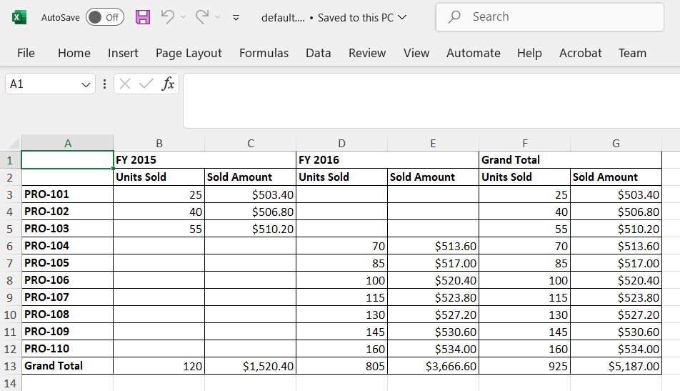

### Add header and footer while exporting

The Excel export provides an option to include header and footer content for the excel document before exporting. In-order to add header and footer, define [header](https://ej2.syncfusion.com/documentation/api/grid/excelexportproperties#header) and [footer](https://ej2.syncfusion.com/documentation/api/grid/excelexportproperties#footer) properties in [ExcelExportProperties](https://ej2.syncfusion.com/documentation/api/grid/excelexportproperties) and pass it as a parameter to the [excelExport](https://ej2.syncfusion.com/documentation/api/pivotview/index-default#excelexport) method.


```ts
let pivotTableObj: PivotView = new PivotView({
     dataSourceSettings: {
        url: 'https://services.syncfusion.com/js/production/api/pivot/post',
        mode: 'Server',
        columns: [ { name: 'Year', caption: 'Production Year' }],
        values: [
            { name: 'Sold', caption: 'Units Sold' },
            { name: 'Amount', caption: 'Sold Amount' }
        ],
        rows: [{ name: 'Country' }, {name: 'Products'}],
        formatSettings: [{ name: 'Amount', format: 'C0' }, { name: 'Sold', format: 'N0' }]
    },
    allowExcelExport: true,
    height: 320
});
pivotTableObj.appendTo('#PivotTable');

let exportBtn: Button = new Button({ isPrimary: true });
exportBtn.appendTo('#excel');

document.getElementById('excel').onclick = function () {
    let excelExportProperties: ExcelExportProperties = {
        header: {
            headerRows: 2,
            rows: [
                { cells: [{ colSpan: 13, value: "Pivot Table", style: { fontColor: '#C67878', fontSize: 20, hAlign: 'Center', bold: true, underline: true } }] }
            ]
        },
        footer: {
            footerRows: 4,
            rows: [
                { cells: [{ colSpan: 13, value: "Thank you for your business! Visit Again!", style: { hAlign: 'Center', bold: true } }] },
                { cells: [{ colSpan: 13, value: "!Visit Again!", style: { hAlign: 'Center', bold: true } }] }
            ]
        }
    };
    pivotTableObj.excelExport(excelExportProperties);
};

```

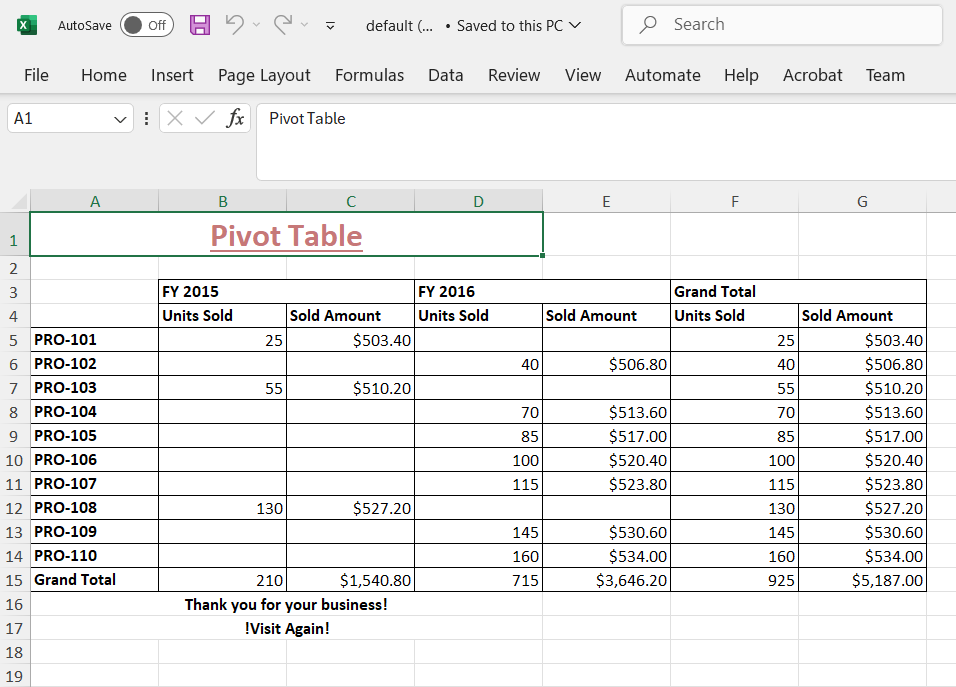

## CSV Export

The Excel export allows pivot table data to be exported in **CSV** file format as well. To enable CSV export in the pivot table, set the [`allowExcelExport`](https://ej2.syncfusion.com/documentation/api/pivotview/index-default#allowexcelexport) property as **true**. Once the API is set, the user needs to call the [csvExport](https://ej2.syncfusion.com/documentation/api/pivotview/index-default#csvexport) method to export the pivot table to CSV by clicking an external button.

> The pivot table component can be exported to CSV format using options available in the toolbar. For more details [refer](./tool-bar) here.


```ts
let pivotTableObj: PivotView = new PivotView({
    dataSourceSettings: {
        url: 'https://services.syncfusion.com/js/production/api/pivot/post',
        mode: 'Server',
        columns: [ { name: 'Year', caption: 'Production Year' }],
        values: [
            { name: 'Sold', caption: 'Units Sold' },
            { name: 'Amount', caption: 'Sold Amount' }
        ],
        rows: [{ name: 'Country' }, {name: 'Products'}],
        formatSettings: [{ name: 'Amount', format: 'C0' }, { name: 'Sold', format: 'N0' }]
    },
    allowExcelExport: true,
    height: 320
});
pivotTableObj.appendTo('#PivotTable');

let exportBtn: Button = new Button({ isPrimary: true });
exportBtn.appendTo('#excel');

document.getElementById('excel').onclick = function () {
    pivotTableObj.csvExport();
}

```

To enable export functionality in a server-side controller, initialize the **ExcelExport** class to handle export file generation.

```csharp
 private ExcelExport excelExport = new ExcelExport();
```

Then, based on the **Action** parameter (**onExcelExport** or **onCsvExport**), invoke the **ExportToExcel** method in the **Post** method of the **PivotController.cs** file.

```csharp
    public async Task<object> Post([FromBody]object args)
        {
            FetchData param = JsonConvert.DeserializeObject<FetchData>(args.ToString());
            if (param.Action == "fetchFieldMembers")
            {
                return await GetMembers(param);
            }
            else if (param.Action == "fetchRawData")
            {
                return await GetRawData(param);
            }
             else if (param.Action == "onExcelExport" || param.Action == "onCsvExport" ||
                     param.Action == "onPivotExcelExport" || param.Action == "onPivotCsvExport")
            {
                EngineProperties engine = await GetEngine(param);
                if (param.InternalProperties.EnableVirtualization && param.ExportAllPages)
                {
                    engine = await PivotEngine.PerformAction(engine, param);
                }
                if (param.Action == "onExcelExport")
                {
                    return excelExport.ExportToExcel("Excel", engine, null, param.ExcelExportProperties);
                }
                else if (param.Action == "onPivotExcelExport" || param.Action == "onPivotCsvExport")
                {
                    return pivotExport.ExportAsPivot(param.Action == "onPivotExcelExport" ? ExportType.Excel : ExportType.CSV, engine, param);
                }
                else
                {
                    return excelExport.ExportToExcel("CSV", engine, null, param.ExcelExportProperties);
                }
            }
            else
            {
                return await GetPivotValues(param);
            }
        }
```
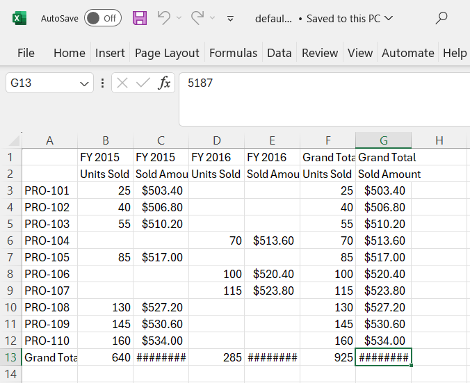

## Export as Pivot

You can export a Syncfusion PivotTable to an Excel file while preserving its native pivot structure using the server-side engine. The exported Excel document contains a fully interactive PivotTable, allowing users to dynamically modify configurations such as filtering, sorting, grouping, and aggregation directly in Microsoft Excel.

To enable native Excel pivot export in the PivotTable, the user must call the `exportAsPivot` method to export the PivotTable to Excel by clicking an external button, specifying the export type (**Excel** or **CSV**) as a parameter.

```ts
let pivotTableObj: PivotView = new PivotView({
    dataSourceSettings: {
        url: 'https://services.syncfusion.com/js/production/api/pivot/post',
        mode: 'Server',
        columns: [ { name: 'Year', caption: 'Production Year' }],
        values: [
            { name: 'Sold', caption: 'Units Sold' },
            { name: 'Amount', caption: 'Sold Amount' }
        ],
        rows: [{ name: 'Country' }, {name: 'Products'}],
        formatSettings: [{ name: 'Amount', format: 'C0' }, { name: 'Sold', format: 'N0' }],
    },
    height: 320,
    allowExcelExport: true
});
pivotTableObj.appendTo('#PivotTable');

let exportBtn: Button = new Button({ isPrimary: true });
exportBtn.appendTo('#excel');

document.getElementById('excel').onclick = function () {
    pivotTableObj.exportAsPivot();
}

```

To enable native Excel pivot export functionality in a server-side controller, initialize the **PivotExportEngine** class to handle export file generation.

```csharp
    private PivotExportEngine<PivotData> pivotExport = new PivotExportEngine<PivotData>();
```

Then, based on the **Action** parameter (**onPivotExcelExport** or **onPivotCsvExport**), invoke the **ExportAsPivot** method in the **Post** method of the **PivotController.cs** file.

```csharp
    public async Task<object> Post([FromBody]object args)
        {
            FetchData param = JsonConvert.DeserializeObject<FetchData>(args.ToString());
            if (param.Action == "fetchFieldMembers")
            {
                return await GetMembers(param);
            }
            else if (param.Action == "fetchRawData")
            {
                return await GetRawData(param);
            }
             else if (param.Action == "onExcelExport" || param.Action == "onCsvExport" ||
                     param.Action == "onPivotExcelExport" || param.Action == "onPivotCsvExport")
            {
                EngineProperties engine = await GetEngine(param);
                if (param.InternalProperties.EnableVirtualization && param.ExportAllPages)
                {
                    engine = await PivotEngine.PerformAction(engine, param);
                }
                if (param.Action == "onExcelExport")
                {
                    return excelExport.ExportToExcel("Excel", engine, null, param.ExcelExportProperties);
                }
                else if (param.Action == "onPivotExcelExport" || param.Action == "onPivotCsvExport")
                {
                    return pivotExport.ExportAsPivot(param.Action == "onPivotExcelExport" ? ExportType.Excel : ExportType.CSV, engine, param);
                }
                else
                {
                    return excelExport.ExportToExcel("CSV", engine, null, param.ExcelExportProperties);
                }
            }
            else
            {
                return await GetPivotValues(param);
            }
        }
```

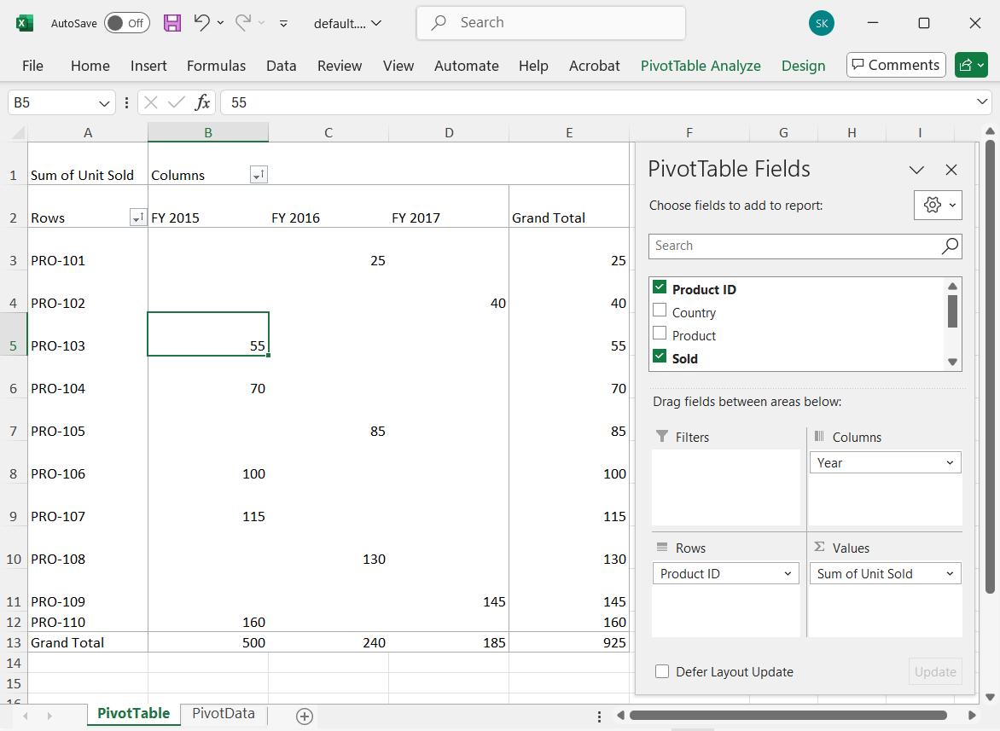

## Secure server requests with beforeServiceInvoke

A Pivot Table wired to a server endpoint may work locally. When pointed at a production API, requests may return 401 errors—not due to invalid queries, but because the server requires credentials. A simple, low‑impact fix is to attach authentication headers immediately before each request leaves the browser.

The Pivot Table exposes a hook for every outgoing call through the [`beforeServiceInvoke`](https://ej2.syncfusion.com/documentation/api/pivotview/beforeserviceinvokeeventargs) event. The event fires just before a request is sent and provides an **args** object, allowing headers to be set via `args.internalProperties.headers`. Using [`beforeServiceInvoke`](https://ej2.syncfusion.com/documentation/api/pivotview/beforeserviceinvokeeventargs) avoids endpoint rewrites or custom transports and provides a single reliable hook that applies to aggregation, sorting, filtering, grouping, exporting, and more.

Use a trusted token issued by the authentication flow after sign‑in. Keep tokens out of source control by retrieving them at runtime (for example, from a secure in‑memory store, a server endpoint that reads an **httpOnly** cookie, or a token manager that refreshes on expiry). Merge the token into request headers so every call carries proof of identity.












**Production tips**
- Load tokens on demand and rotate them regularly; never hard-code secrets in source control.
- When a backend expects a different header (for example, X‑API‑Key), use that header instead of Authorization.
- Configure CORS to allow any custom headers added (for example, include Authorization in Access‑Control‑Allow‑Headers) so browsers do not block requests.

**Troubleshooting**
- 401 or 403: Token is missing, expired, or invalid for the target route.
- CORS preflight error: Server does not allow the custom headers.
- Missing headers: Ensure [`beforeServiceInvoke`](https://ej2.syncfusion.com/documentation/api/pivotview/beforeserviceinvokeeventargs) runs on the same Pivot instance and sets headers on every call.

**Pre‑shipment checks**
- Inspect request headers in the browser Network panel; Authorization (or the configured custom key) must be present on every call.
- Confirm the server reads the same header and maps the value to the authentication middleware.
- Reproduce 401 vs 403 responses during testing to validate end‑to‑end header handling and permissions.

**Summary**
- A single event keeps requests authenticated without API redesign and reduces surprises when moving from local testing to production.
