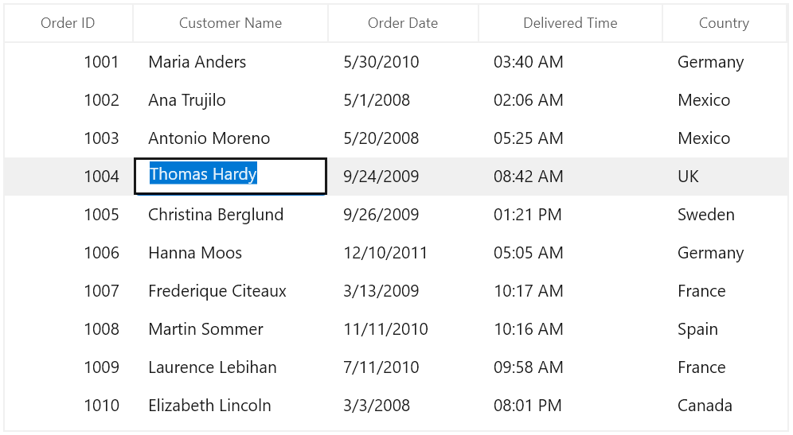
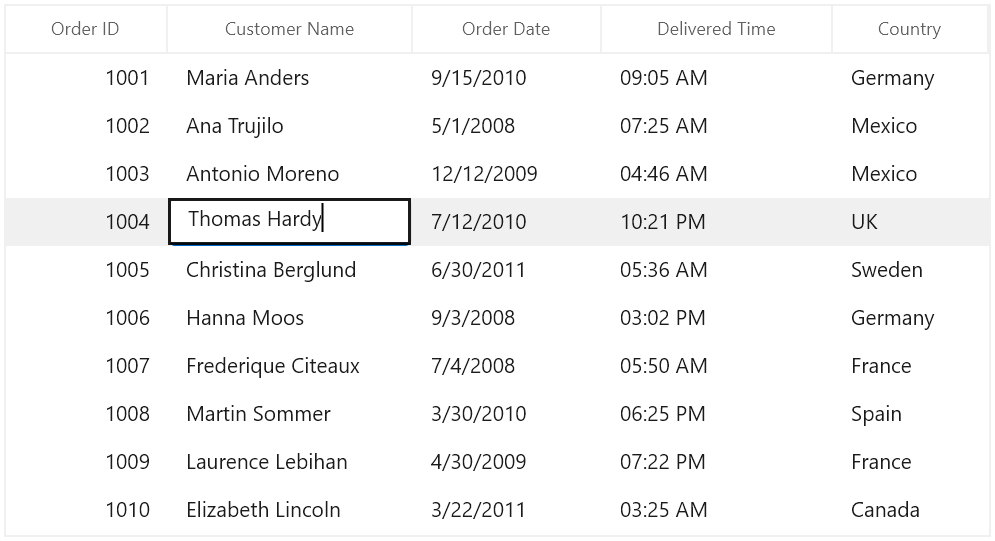

# Editing in WinUI Data Grid

SfDataGrid provides support for editing and it can be enabled or disabled by setting [SfDataGrid.AllowEditing](https://help.syncfusion.com/cr/winui/Syncfusion.UI.Xaml.Grids.SfGridBase.html#Syncfusion_UI_Xaml_Grids_SfGridBase_AllowEditing) property.



<dataGrid:SfDataGrid  x:Name="sfDataGrid"
                        AllowEditing="True"
                        AutoGenerateColumns="True"
                        ItemsSource="{Binding Employees}"/>


sfDataGrid.AllowEditing = true;



You can enable or disable editing for particular column by setting [GridColumn.AllowEditing](https://help.syncfusion.com/cr/winui/Syncfusion.UI.Xaml.Grids.GridColumnBase.html#Syncfusion_UI_Xaml_Grids_GridColumnBase_AllowEditing) property.



<syncfusion:GridTextColumn HeaderText="Employee ID" MappingName="ID" AllowEditing="True"/>


sfDataGrid.Columns["ID"].AllowEditing = true;



N> [GridColumn.AllowEditing](https://help.syncfusion.com/cr/winui/Syncfusion.UI.Xaml.Grids.GridColumnBase.html#Syncfusion_UI_Xaml_Grids_GridColumnBase_AllowEditing) takes higher priority than [SfDataGrid.AllowEditing](https://help.syncfusion.com/cr/winui/Syncfusion.UI.Xaml.Grids.SfGridBase.html#Syncfusion_UI_Xaml_Grids_SfGridBase_AllowEditing).

N> It is mandatory to set the [NavigationMode](https://help.syncfusion.com/cr/winui/Syncfusion.UI.Xaml.Grids.SfGridBase.html#Syncfusion_UI_Xaml_Grids_SfGridBase_NavigationMode) to Cell to enable [CurrentCell](https://help.syncfusion.com/cr/winui/Syncfusion.UI.Xaml.DataGrid.GridCurrentCellManager.html#Syncfusion_UI_Xaml_DataGrid_GridCurrentCellManager_CurrentCell) navigation and editing.

## Entering into edit mode

You can enter into edit mode by pressing <kbd>F2</kbd> key or clicking (touch also supported) the cell. You can allow users to edit the cell in single click (OnTap) or double click (OnDoubleTap) by setting [EditTrigger](https://help.syncfusion.com/cr/winui/Syncfusion.UI.Xaml.Grids.SfGridBase.html#Syncfusion_UI_Xaml_Grids_SfGridBase_EditTrigger) property.



<dataGrid:SfDataGrid  x:Name="sfDataGrid"
                        AllowEditing="True"
                        EditTrigger="OnDoubleTap"
                        AutoGenerateColumns="True"
                        ItemsSource="{Binding Employees}"/>


sfDataGrid.EditTrigger = EditTrigger.OnDoubleTap;



## Non-Alphanumeric Key Type-to-Edit

SfDataGrid supports type-to-edit in WinUI. When a cell is the current cell and is not in edit mode, typing a character begins editing that cell with the typed character. The grid handles the composed character received from the keyboard (the `CharacterReceived` event) instead of the pressed key. Hence, non-alphanumeric characters such as symbols and punctuation (for example `@`, `#`, `-`, `.` and `,`) begin editing in the same way as letters and digits.



<dataGrid:SfDataGrid x:Name="sfDataGrid"
                     AllowEditing="True"
                     NavigationMode="Cell"
                     AutoGenerateColumns="False"
                     ItemsSource="{Binding Employees}">
    <dataGrid:SfDataGrid.Columns>
        <dataGrid:GridTextColumn HeaderText="Employee Name" MappingName="Name" />
        <dataGrid:GridNumericColumn HeaderText="Salary" MappingName="Salary" />
    </dataGrid:SfDataGrid.Columns>
</dataGrid:SfDataGrid>


sfDataGrid.AllowEditing = true;
sfDataGrid.NavigationMode = NavigationMode.Cell;



The behavior of the typed character depends on the column type of the current cell.

* **GridTextColumn** – the typed character replaces the existing cell text, and the cursor is placed after the typed character. The character is applied irrespective of the [EditorSelectionBehavior](https://help.syncfusion.com/cr/winui/Syncfusion.UI.Xaml.Grids.SfGridBase.html#Syncfusion_UI_Xaml_Grids_SfGridBase_EditorSelectionBehavior) value.
* **GridNumericColumn** – the behavior depends on the typed character:
    * A decimal digit of any script (for example, Arabic-Indic or full-width digits) replaces the existing value with that digit.
    * The negative sign, positive sign, or decimal separator of the current culture is entered in the editor text, and the cursor is placed after it.
    * Any other character opens the editor with the existing value, and the character is not applied.
* **Other column types** – the editor opens with the existing value, and the typed character is not applied.

### Cases that do not begin editing

Type-to-edit does not begin editing in the following cases:

* The character is a control character, a white-space character (including <kbd>Space</kbd>), or a surrogate character (for example, emoji).
* Only <kbd>Ctrl</kbd> or only <kbd>Alt</kbd> is pressed along with the key, or a Windows logo key is pressed. These combinations are treated as shortcuts. <kbd>Ctrl</kbd> + <kbd>Alt</kbd> is treated as text because AltGr is reported as <kbd>Ctrl</kbd> + <kbd>Alt</kbd>.
* The current cell is already in edit mode. The editor handles the characters.
* [NavigationMode](https://help.syncfusion.com/cr/winui/Syncfusion.UI.Xaml.Grids.SfGridBase.html#Syncfusion_UI_Xaml_Grids_SfGridBase_NavigationMode) is not set to `Cell`, or there is no current cell.
* The current cell belongs to a template column.
* The input originates from a control hosted inside a cell or from a nested details-view grid. The input belongs to that control.

### Read-only and non-editable cells

The typed character is ignored, and editing does not begin, when the current cell cannot enter edit mode. This applies when editing is disabled for the column, the column is read-only, or the edit is canceled in the [CurrentCellBeginEdit](https://help.syncfusion.com/cr/winui/Syncfusion.UI.Xaml.DataGrid.SfDataGrid.html#Syncfusion_UI_Xaml_DataGrid_SfDataGrid_CurrentCellBeginEdit) event.



<dataGrid:GridTextColumn HeaderText="Employee Name" MappingName="Name" AllowEditing="False" />


sfDataGrid.Columns["Name"].AllowEditing = false;



When type-to-edit begins editing, the `CurrentCellBeginEdit` event is raised in the same way as when editing begins through the <kbd>F2</kbd> key or by clicking the cell.

N> Type-to-edit in WinUI is triggered only by the received character, so a single key press never begins editing twice.

N> Verification Required – Source information unavailable: type-to-edit behavior with input method editors (IME) was not verified from the implementation source code.

## Cursor placement

When the cell enters into edit mode, cursor is placed based on [EditorSelectionBehavior](https://help.syncfusion.com/cr/winui/Syncfusion.UI.Xaml.Grids.SfGridBase.html#Syncfusion_UI_Xaml_Grids_SfGridBase_EditorSelectionBehavior) property.
 
`SelectAll` – selects the text of edit element loaded inside cell.

`MoveLast` – places the cursor at the last of edit element loaded inside cell.



<dataGrid:SfDataGrid  x:Name="sfDataGrid"
                        AllowEditing="True"
                        EditorSelectionBehavior="MoveLast"
                        AutoGenerateColumns="True"
                        ItemsSource="{Binding Employees}"/>


sfDataGrid.EditorSelectionBehavior = EditorSelectionBehavior.MoveLast;



## Retain editing on lost focus

The editing of current cell will be ended by default while the focus is moving from DataGrid to another control. You can set the [LostFocusBehavior](https://help.syncfusion.com/cr/winui/Syncfusion.UI.Xaml.DataGrid.SfDataGrid.html#Syncfusion_UI_Xaml_DataGrid_SfDataGrid_LostFocusBehavior) property to `LostFocusBehavior.Default` if you want to retain the editing of the current cell even when focus is moved to another control.



<dataGrid:SfDataGrid  x:Name="sfDataGrid"
                        AllowEditing="True"
                        AutoGenerateColumns="True"
                        LostFocusBehavior="Default"
                        ItemsSource="{Binding Employees}"/>



sfDataGrid.LostFocusBehavior = LostFocusBehavior.Default;



## Events

SfDataGrid triggers the following events during editing.
 
### CurrentCellBeginEdit Event

[CurrentCellBeginEdit](https://help.syncfusion.com/cr/winui/Syncfusion.UI.Xaml.DataGrid.SfDataGrid.html#Syncfusion_UI_Xaml_DataGrid_SfDataGrid_CurrentCellBeginEdit) event occurs when the [CurrentCell](https://help.syncfusion.com/cr/winui/Syncfusion.UI.Xaml.DataGrid.GridCurrentCellManager.html#Syncfusion_UI_Xaml_DataGrid_GridCurrentCellManager_CurrentCell) enter into edit mode. [CurrentCellBeginEditEventArgs](https://help.syncfusion.com/cr/winui/Syncfusion.UI.Xaml.DataGrid.CurrentCellBeginEditEventArgs.html) has following members which provides information for `CurrentCellBeginEdit` event.

* [Cancel](https://docs.microsoft.com/en-us/dotnet/api/system.componentmodel.canceleventargs.cancel?view=net-6.0): When set to ‘true’, the event is canceled and the `CurrentCell` does not enter into the edit mode.

* [RowColumnIndex](https://help.syncfusion.com/cr/winui/Syncfusion.UI.Xaml.DataGrid.CurrentCellBeginEditEventArgs.html#Syncfusion_UI_Xaml_DataGrid_CurrentCellBeginEditEventArgs_RowColumnIndex): Gets the current row column index of the DataGrid.

* [Column](https://help.syncfusion.com/cr/winui/Syncfusion.UI.Xaml.DataGrid.CurrentCellBeginEditEventArgs.html#Syncfusion_UI_Xaml_DataGrid_CurrentCellBeginEditEventArgs_Column): Gets the Grid Column of the SfDataGrid.



this.sfDataGrid.CurrentCellBeginEdit += SfDataGrid_CurrentCellBeginEdit;

private void SfDataGrid_CurrentCellBeginEdit(object sender, CurrentCellBeginEditEventArgs e)
{
    
}




### CurrentCellEndEdit Event

[CurrentCellEndEdit](https://help.syncfusion.com/cr/winui/Syncfusion.UI.Xaml.DataGrid.SfDataGrid.html#Syncfusion_UI_Xaml_DataGrid_SfDataGrid_CurrentCellEndEdit) event occurs when the [CurrentCell](https://help.syncfusion.com/cr/winui/Syncfusion.UI.Xaml.DataGrid.GridCurrentCellManager.html#Syncfusion_UI_Xaml_DataGrid_GridCurrentCellManager_CurrentCell) exits the edit mode. [CurrentCellEndEditEventArgs](https://help.syncfusion.com/cr/winui/Syncfusion.UI.Xaml.DataGrid.CurrentCellEndEditEventArgs.html) has following members which provides information for `CurrentCellEndEdit` event.

* [RowColumnIndex](https://help.syncfusion.com/cr/winui/Syncfusion.UI.Xaml.DataGrid.CurrentCellEndEditEventArgs.html#Syncfusion_UI_Xaml_DataGrid_CurrentCellEndEditEventArgs_RowColumnIndex): Gets the value for the current row column index.



this.sfDataGrid.CurrentCellEndEdit += SfDataGrid_CurrentCellEndEdit;

private void SfDataGrid_CurrentCellEndEdit(object sender, CurrentCellEndEditEventArgs e)
{
    
}




### CurrentCellValueChanged Event

[CurrentCellValueChanged](https://help.syncfusion.com/cr/winui/Syncfusion.UI.Xaml.DataGrid.SfDataGrid.html#Syncfusion_UI_Xaml_DataGrid_SfDataGrid_CurrentCellValueChanged) event occurs whenever a value changes in GridColumn’s that supports editing.

[CurrentCellValueChangedEventArgs](https://help.syncfusion.com/cr/winui/Syncfusion.UI.Xaml.DataGrid.CurrentCellValueChangedEventArgs.html) has following members which provides information for `CurrentCellValueChanged` event.

* [Column](https://help.syncfusion.com/cr/winui/Syncfusion.UI.Xaml.DataGrid.CurrentCellValueChangedEventArgs.html#Syncfusion_UI_Xaml_DataGrid_CurrentCellValueChangedEventArgs_Column): Gets the Grid Column of the SfDataGrid.

* [RowColumnIndex](https://help.syncfusion.com/cr/winui/Syncfusion.UI.Xaml.DataGrid.CurrentCellValueChangedEventArgs.html#Syncfusion_UI_Xaml_DataGrid_CurrentCellValueChangedEventArgs_RowColumnIndex): Gets the value of the current RowColumnIndex.

* [Record](https://help.syncfusion.com/cr/winui/Syncfusion.UI.Xaml.DataGrid.CurrentCellValueChangedEventArgs.html#Syncfusion_UI_Xaml_DataGrid_CurrentCellValueChangedEventArgs_Record): Gets the record of the corresponding cell value changes.



this.sfDataGrid.CurrentCellValueChanged += SfDataGrid_CurrentCellValueChanged;

private void SfDataGrid_CurrentCellValueChanged(object sender, CurrentCellValueChangedEventArgs e)
{
   
}




N> For GridComboBoxColumn, you have to use the CurrentCellDropDownSelectionChanged event.

### CurrentCellDropDownSelectionChanged Event

[CurrentCellDropDownSelectionChanged](https://help.syncfusion.com/cr/winui/Syncfusion.UI.Xaml.DataGrid.SfDataGrid.html#Syncfusion_UI_Xaml_DataGrid_SfDataGrid_CurrentCellDropDownSelectionChanged) event occurs whenever the `SelectedItem` of  `GridComboBoxColumn` column changed.

[CurrentCellDropDownSelectionChangedEventArgs](https://help.syncfusion.com/cr/winui/Syncfusion.UI.Xaml.Grids.CurrentCellDropDownSelectionChangedEventArgs.html) has following members which provides information for `CurrentCellDropDownSelectionChanged` event.

* [RowColumnIndex](https://help.syncfusion.com/cr/winui/Syncfusion.UI.Xaml.Grids.CurrentCellDropDownSelectionChangedEventArgs.html#Syncfusion_UI_Xaml_Grids_CurrentCellDropDownSelectionChangedEventArgs_RowColumnIndex) –  Gets the RowColumnIndex of the corresponding item that were selected from the drop-down control.

* [SelectedIndex](https://help.syncfusion.com/cr/winui/Syncfusion.UI.Xaml.Grids.CurrentCellDropDownSelectionChangedEventArgs.html#Syncfusion_UI_Xaml_Grids_CurrentCellDropDownSelectionChangedEventArgs_SelectedIndex) – Gets the index of the corresponding item that were selected from the drop-down control.

* [SelectedItem](https://help.syncfusion.com/cr/winui/Syncfusion.UI.Xaml.Grids.CurrentCellDropDownSelectionChangedEventArgs.html#Syncfusion_UI_Xaml_Grids_CurrentCellDropDownSelectionChangedEventArgs_SelectedItem) – Gets the data item that were selected from the drop-down control.



this.sfDataGrid.CurrentCellDropDownSelectionChanged += SfDataGrid_CurrentCellDropDownSelectionChanged;

private void SfDataGrid_CurrentCellDropDownSelectionChanged(object sender, CurrentCellDropDownSelectionChangedEventArgs e)
{
    
}




### CellTapped Event

[CellTapped](https://help.syncfusion.com/cr/winui/Syncfusion.UI.Xaml.DataGrid.SfDataGrid.html#Syncfusion_UI_Xaml_DataGrid_SfDataGrid_CellTapped) event occurs when the user clicks or touches the `Cell` in SfDataGrid with [GridCellTappedEventArgs](https://help.syncfusion.com/cr/winui/Syncfusion.UI.Xaml.DataGrid.GridCellTappedEventArgs.html). CellTapped event does not occur for the non-selectable cells. The GridCellTappedEventArgs has following members which provides information for `CellTapped` event.
* [Column](https://help.syncfusion.com/cr/winui/Syncfusion.UI.Xaml.DataGrid.CellTappedEventArgs.html#Syncfusion_UI_Xaml_DataGrid_CellTappedEventArgs_Column) - Gets the GridColumn of the tapped cell.

* [Record](https://help.syncfusion.com/cr/winui/Syncfusion.UI.Xaml.DataGrid.CellTappedEventArgs.html#Syncfusion_UI_Xaml_DataGrid_CellTappedEventArgs_Record) - Gets the data context of the tapped cell.

* [RowColumnIndex](https://help.syncfusion.com/cr/winui/Syncfusion.UI.Xaml.DataGrid.CellTappedEventArgs.html#Syncfusion_UI_Xaml_DataGrid_CellTappedEventArgs_RowColumnIndex) - Gets the RowColumnIndex of the tapped cell.

* [PointerDeviceType](https://help.syncfusion.com/cr/winui/Syncfusion.UI.Xaml.DataGrid.CellTappedEventArgs.html#Syncfusion_UI_Xaml_DataGrid_CellTappedEventArgs_PointerDeviceType) - Gets the device type that associated with the event.

* [OriginalSender](https://help.syncfusion.com/cr/winui/Syncfusion.UI.Xaml.Grids.GridEventArgs.html#Syncfusion_UI_Xaml_Grids_GridEventArgs_OriginalSender) - Gets the original reporting source that raised the event.  



<dataGrid:SfDataGrid  x:Name="sfDataGrid"
                        CellTapped="SfDataGrid_CellTapped"             
                        AutoGenerateColumns="True"
                        ItemsSource="{Binding Employees}"/>


this.sfDataGrid.CellTapped += SfDataGrid_CellTapped;

private void SfDataGrid_CellTapped(object sender, GridCellTappedEventArgs e)
{
   
}



### CellDoubleTapped Event
[CellDoubleTapped](https://help.syncfusion.com/cr/winui/Syncfusion.UI.Xaml.DataGrid.SfDataGrid.html#Syncfusion_UI_Xaml_DataGrid_SfDataGrid_CellDoubleTapped) event occurs when the user double clicks or double taps the `GridCell` in SfDataGrid with [GridCellDoubleTappedEventArgs](https://help.syncfusion.com/cr/winui/Syncfusion.UI.Xaml.DataGrid.CellDoubleTappedEventArgs.html). CellDoubleTapped event does not occur for non-selectable cells. GridCellDoubleTappedEventArgs has following members which provides information for `CellDoubleTapped ` event.

* [Column](https://help.syncfusion.com/cr/winui/Syncfusion.UI.Xaml.DataGrid.CellDoubleTappedEventArgs.html#Syncfusion_UI_Xaml_DataGrid_CellDoubleTappedEventArgs_Column) - Gets the GridColumn of the double tapped cell.

* [Record](https://help.syncfusion.com/cr/winui/Syncfusion.UI.Xaml.DataGrid.CellDoubleTappedEventArgs.html#Syncfusion_UI_Xaml_DataGrid_CellDoubleTappedEventArgs_Record) - Gets the data context of the double tapped cell.

* [RowColumnIndex](https://help.syncfusion.com/cr/winui/Syncfusion.UI.Xaml.DataGrid.CellDoubleTappedEventArgs.html#Syncfusion_UI_Xaml_DataGrid_CellDoubleTappedEventArgs_RowColumnIndex) - Gets the RowColumnIndex of the double tapped cell.

* [PointerDeviceType](https://help.syncfusion.com/cr/winui/Syncfusion.UI.Xaml.DataGrid.CellDoubleTappedEventArgs.html#Syncfusion_UI_Xaml_DataGrid_CellDoubleTappedEventArgs_PointerDeviceType) - Gets the device type that associated with the event.

* [OriginalSender](https://help.syncfusion.com/cr/winui/Syncfusion.UI.Xaml.Grids.GridEventArgs.html#Syncfusion_UI_Xaml_Grids_GridEventArgs_OriginalSender) - Gets the original reporting source that raised the event



<dataGrid:SfDataGrid  x:Name="sfDataGrid"
                        CellDoubleTapped="SfDataGrid_CellDoubleTapped"
                        AutoGenerateColumns="True"
                        ItemsSource="{Binding Employees}"/>


this.sfDataGrid.CellDoubleTapped += SfDataGrid_CellDoubleTapped;

private void SfDataGrid_CellDoubleTapped(object sender, GridCellDoubleTappedEventArgs e)
{
    
}




## Programmatically edit the cell

### BeginEdit

SfDataGrid allows you to edit the cell programmatically by calling the [BeginEdit](https://help.syncfusion.com/cr/winui/Syncfusion.UI.Xaml.DataGrid.GridCurrentCellManager.html#Syncfusion_UI_Xaml_DataGrid_GridCurrentCellManager_BeginEdit) method. Initially the [CurrentCell](https://help.syncfusion.com/cr/winui/Syncfusion.UI.Xaml.DataGrid.GridCurrentCellManager.html#Syncfusion_UI_Xaml_DataGrid_GridCurrentCellManager_CurrentCell) need to set before calling the `BeginEdit` method when the CurrentCell value is null.




//Add this namespace to access the RowColumnIndex structure type in SfDataGrid 
using Syncfusion.UI.Xaml.Grids.ScrollAxis;

this.sfDataGrid.Loaded += SfDataGrid_Loaded; 

private void SfDataGrid_Loaded(object sender, RoutedEventArgs e)
{
    RowColumnIndex rowColumnIndex = new RowColumnIndex(3, 2);
    this.sfDataGrid.MoveCurrentCell(rowColumnIndex);
    this.sfDataGrid.SelectionController.CurrentCellManager.BeginEdit();
}




### EndEdit

You can call the [EndEdit](https://help.syncfusion.com/cr/winui/Syncfusion.UI.Xaml.DataGrid.GridCurrentCellManager.html#Syncfusion_UI_Xaml_DataGrid_GridCurrentCellManager_EndEdit_System_Boolean_) method to programmatically end edit. 



this.sfDataGrid.SelectionController.CurrentCellManager.EndEdit();



### CancelEdit

You can use the [CurrentCellBeginEdit](https://help.syncfusion.com/cr/winui/Syncfusion.UI.Xaml.DataGrid.SfDataGrid.html#Syncfusion_UI_Xaml_DataGrid_SfDataGrid_CurrentCellBeginEdit) event to cancel the editing operation for the corresponding cell.




//Add this namespace to access the RowColumnIndex structure type in SfDataGrid
using Syncfusion.UI.Xaml.Grids.ScrollAxis;

this.sfDataGrid.CurrentCellBeginEdit += SfDataGrid_CurrentCellBeginEdit;

private void SfDataGrid_CurrentCellBeginEdit(object sender, CurrentCellBeginEditEventArgs e)
{
    var recordIndex = this.sfDataGrid.ResolveToRecordIndex(e.RowColumnIndex.RowIndex);
    var columnIndex = this.sfDataGrid.ResolveToGridVisibleColumnIndex(e.RowColumnIndex.ColumnIndex);
    var mappingName = this.sfDataGrid.Columns[columnIndex].MappingName;
    var record = this.sfDataGrid.View.Records.GetItemAt(recordIndex);
    var cellValue = this.sfDataGrid.View.GetPropertyAccessProvider().GetValue(record, mappingName);

    if (e.RowColumnIndex == new RowColumnIndex(3, 2))
        e.Cancel = true;
}




