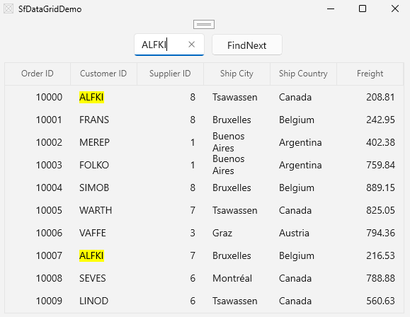
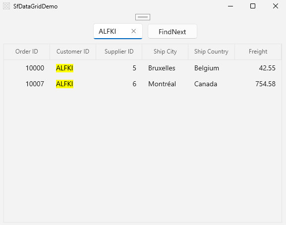
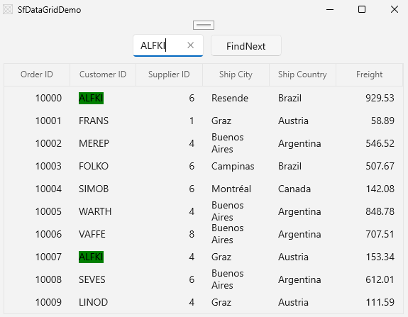
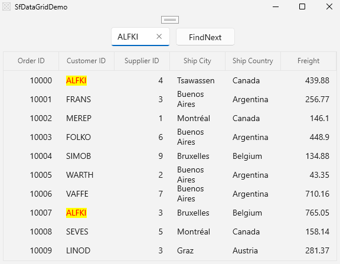
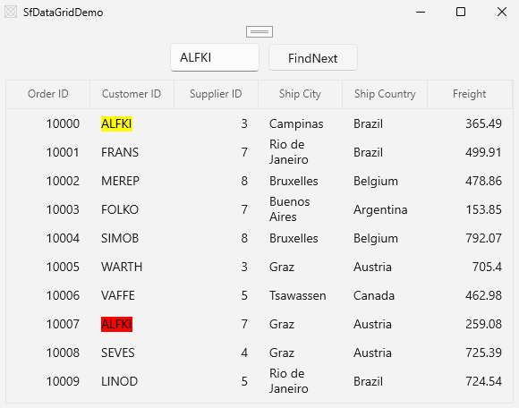
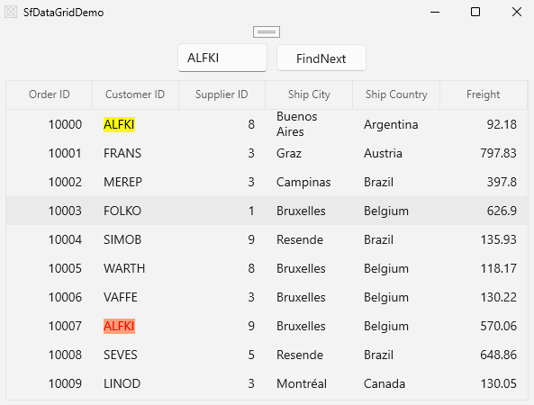
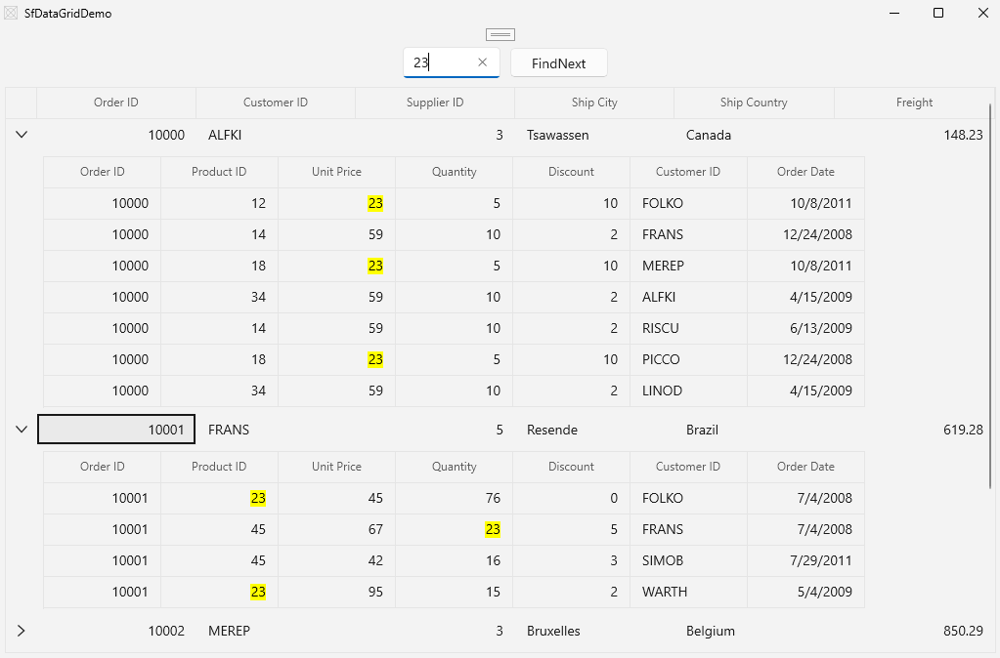
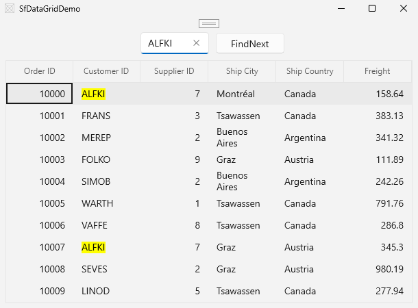

# Search in WinUI Data Grid

SfDataGrid allows you to search the data displayed in the grid and highlight the matching text in cells. The search operation is performed by the `SearchHelper` class, which is available through the `SfDataGrid.SearchHelper` property.

## Enable searching

Searching is disabled by default. Enable it for all columns by setting `SearchHelper.AllowSearching` to `true`, and then call the `SearchHelper.Search` method with the text to find.



this.sfDataGrid.SearchHelper.AllowSearching = true;
this.sfDataGrid.SearchHelper.Search(searchTextBox.Text);



N> If `SearchHelper.AllowSearching` is `false` and no column sets `GridColumn.AllowSearching` to `true`, the `Search`, `FindNext` and `FindPrevious` methods do nothing.

### Enable searching for specific columns

You can include or exclude individual columns by setting the `GridColumn.AllowSearching` property.



<dataGrid:SfDataGrid x:Name="sfDataGrid"
                     AutoGenerateColumns="False"
                     ItemsSource="{Binding Orders}">
    <dataGrid:SfDataGrid.Columns>
        <dataGrid:GridTextColumn AllowSearching="True" MappingName="OrderID" />
        <dataGrid:GridTextColumn AllowSearching="True" MappingName="CustomerName" />
        <dataGrid:GridTextColumn AllowSearching="False" MappingName="ShipCity" />
    </dataGrid:SfDataGrid.Columns>
</dataGrid:SfDataGrid>


this.sfDataGrid.Columns["OrderID"].AllowSearching = true;
this.sfDataGrid.Columns["ShipCity"].AllowSearching = false;



N> `GridColumn.AllowSearching` takes higher priority than `SearchHelper.AllowSearching`. A column that does not set the property uses the value of `SearchHelper.AllowSearching`.

## Search type

Use the `SearchHelper.SearchType` property to specify how the cell text is compared with the search text. The default value is `SearchType.Contains`.

| SearchType | Description |
|---|---|
| `Contains` | Matches cells that contain the search text. |
| `StartsWith` | Matches cells that start with the search text. |
| `EndsWith` | Matches cells that end with the search text. |



this.sfDataGrid.SearchHelper.AllowSearching = true;
this.sfDataGrid.SearchHelper.SearchType = SearchType.StartsWith;
this.sfDataGrid.SearchHelper.Search(searchTextBox.Text);



## Case-sensitive search

Search is case-insensitive by default. Set `SearchHelper.AllowCaseSensitiveSearch` to `true` to match the case of the search text. If search text is already applied, changing this property re-runs the search.



this.sfDataGrid.SearchHelper.AllowCaseSensitiveSearch = true;



## Filtering based on search

Set `SearchHelper.AllowFiltering` to `true` to display only the rows that contain the search text. The default value is `false`.



this.sfDataGrid.SearchHelper.AllowSearching = true;
this.sfDataGrid.SearchHelper.AllowFiltering = true;
this.sfDataGrid.SearchHelper.Search(searchTextBox.Text);



N> Setting `AllowFiltering` assigns the search filter to `SfDataGrid.View.Filter`. Setting it back to `false` removes the view filter.

## Changing Search Highlight Background

In WinUI DataGrid (SfDataGrid), you can change the search text highlighting color by setting `SearchHelper.SearchBrush` property. 




this.sfDataGrid.SearchHelper.SearchBrush = new SolidColorBrush(Colors.Red);
this.sfDataGrid.SearchHelper.Search(searchTextBox.Text);




## Changing foreground for search highlight

In WinUI DataGrid (SfDataGrid), you can change the foreground color for search text by setting the `SearchHelper.SearchForegroundBrush` property. 




this.sfDataGrid.SearchHelper.SearchForegroundBrush = new SolidColorBrush(Colors.Red);




## Navigating between matches

Use the `SearchHelper.FindNext` and `SearchHelper.FindPrevious` methods to move to the next or previous matching cell. Both methods return `true` when a matching cell is found, scroll the cell into view when needed, and highlight it by using `SearchHighlightBrush`.



this.sfDataGrid.SearchHelper.AllowSearching = true;
this.sfDataGrid.SearchHelper.FindNext(searchTextBox.Text);
this.sfDataGrid.SearchHelper.FindPrevious(searchTextBox.Text);



The position of the current match is available in the `SearchHelper.CurrentRowColumnIndex` property.

You can highlight the currently navigated search text using `SearchHelper.SearchHighlightBrush` property.




this.sfDataGrid.SearchHelper.SearchHighlightBrush = new SolidColorBrush(Colors.Red);
this.sfDataGrid.SearchHelper.AllowSearching = true;
this.sfDataGrid.SearchHelper.FindNext(searchTextBox.Text);




You can highlight the foreground color of current navigated search text by using the `SearchHelper.SearchForegroundHighlightBrush` property.




this.sfDataGrid.SearchHelper.SearchForegroundHighlightBrush = new SolidColorBrush(Colors.Red);




### Moving the current cell to the match

`FindNext` and `FindPrevious` do not move the current cell. To move it, pass `CurrentRowColumnIndex` to the `SfDataGrid.MoveCurrentCell` method.



if (this.sfDataGrid.SearchHelper.FindNext(searchTextBox.Text))
    this.sfDataGrid.MoveCurrentCell(this.sfDataGrid.SearchHelper.CurrentRowColumnIndex);



N> `MoveCurrentCell` is not applicable when `SelectionUnit` and `NavigationMode` are `Row`.

## Clearing search

Call `SearchHelper.ClearSearch` to remove the highlighting and reset `CurrentRowColumnIndex`. Calling `Search` with an empty string also clears the search.



this.sfDataGrid.SearchHelper.ClearSearch();



## Getting the matching records

The `SearchHelper.GetSearchRecords` method returns a `List<GridSearchCellInfo>`. Each item contains the matching `Record` and the `ColumnCollection` of columns in which the text matched. The method returns `null` when no search text is applied.



this.sfDataGrid.SearchHelper.Search(searchTextBox.Text);
var searchRecords = this.sfDataGrid.SearchHelper.GetSearchRecords();
if (searchRecords != null && searchRecords.Count > 0)
{
    var firstRecord = searchRecords[0].Record;
    var matchedColumns = searchRecords[0].ColumnCollection;
}



## Search in Master-Details View
Master-details view allows you to search the data by using `SearchHelper.Search` method in the [ViewDefinition.DataGrid](https://help.syncfusion.com/cr/winui/Syncfusion.UI.Xaml.DataGrid.GridViewDefinition.html#Syncfusion_UI_Xaml_DataGrid_GridViewDefinition_DataGrid).




(this.sfDataGrid.DetailsViewDefinition[0] as GridViewDefinition).DataGrid.SearchHelper.AllowSearching = true;
(this.sfDataGrid.DetailsViewDefinition[0] as GridViewDefinition).DataGrid.SearchHelper.Search(TextBox.Text);




N> In a Master-Details view, each DetailsViewDataGrid maintains its own SearchHelper instance. SearchHelper settings defined on the parent grid are **not inherited** by child detail grids. Therefore, all SearchHelper-related properties (such as AllowCaseSensitiveSearch, AllowSearching, SearchType, brushes, and other search customization settings) must be configured separately for each details grid.

### Navigating cells based on search text in DetailsViewDataGrid

You can navigate to the cells contains the SearchText using `SearchHelper.FindNext` and `SearchHelper.FindPrevious` methods in [ViewDefinition.DataGrid](https://help.syncfusion.com/cr/winui/Syncfusion.UI.Xaml.DataGrid.GridViewDefinition.html#Syncfusion_UI_Xaml_DataGrid_GridViewDefinition_DataGrid).




(this.sfDataGrid.DetailsViewDefinition[0] as GridViewDefinition).DataGrid.SearchHelper.AllowSearching = true;
(this.sfDataGrid.DetailsViewDefinition[0] as GridViewDefinition).DataGrid.SearchHelper.FindNext(SearchBox.Text);
(this.sfDataGrid.DetailsViewDefinition[0] as GridViewDefinition).DataGrid.SearchHelper.FindPrevious(SearchBox.Text);




N> It is not possible to Navigate with the two DataGrid at a time.

## Search customization

You can change the default search behavior by deriving from `SearchHelper` and assigning the instance to `SfDataGrid.SearchHelper`.



this.sfDataGrid.SearchHelper = new SearchHelperExt(this.sfDataGrid);

public class SearchHelperExt : SearchHelper
{
    public SearchHelperExt(SfDataGrid dataGrid) : base(dataGrid)
    {
    }
}



### Select the record based on the SearchText

You can select the records which contains the search text by using `GetSearchedRecord` method. 




this.sfDataGrid.SelectedItems.Clear();
this.sfDataGrid.SearchHelper.AllowSearching = true;
this.sfDataGrid.SearchHelper.Search("SearchText");
var list = this.sfDataGrid.SearchHelper.GetSearchRecords();
if (list != null && list.Count > 0)
{
    int recordIndex = this.sfDataGrid.ResolveToRecordIndex(this.sfDataGrid.ResolveToRowIndex(list[0].Record));
    this.sfDataGrid.SelectedIndex = recordIndex;
}




### Search in GridComboBoxColumn

Search highlights text only in cells that display a `TextBlock`. `GridComboBoxColumn` loads a `ContentControl` in display mode, so its cells are not searched by default. To search a `GridComboBoxColumn`, create a column and a renderer that display a `TextBlock`.

**Step 1:** Derive from `GridComboBoxColumn` and set a new cell type. 



public class ComboBoxColumnExt : GridComboBoxColumn
{
    public ComboBoxColumnExt()
    {
        SetCellType("ComboBoxExt");
    }
}



**Step 2:** Create a renderer that uses `TextBlock` as the display element and `SfComboBox` as the edit element.



public class ComboBoxRendererExt : GridVirtualizingCellRenderer<TextBlock, SfComboBox>
{

    public ComboBoxRendererExt()
    {
    }

    public override object GetControlValue()
    {
        if (!HasCurrentCellState)
            return null;
        return CurrentCellRendererElement.GetValue(IsInEditing ? SfComboBox.SelectedValueProperty : TextBlock.TextProperty);
    }

    // Creates the binding to the Edit-element
    private void InitializeEditBinding(SfComboBox uiElement, GridColumn column)
    {
        var comboBoxColumn = (GridComboBoxColumn)column;
        var source = comboBoxColumn.ValueBinding as Binding;

        // Creates the bind element to the edit-element.
        var bind = new Binding
        {
            Mode = BindingMode.TwoWay,
            Path = source.Path,
            
        };

        uiElement.SetBinding(ComboBox.SelectedValueProperty, bind);

        // Binding the ItemSource to the GridComboBox.
        var itemsSourceBinding = new Binding { Path = new PropertyPath("ItemsSource"), Mode = BindingMode.TwoWay, Source = comboBoxColumn };
        uiElement.SetBinding(ComboBox.ItemsSourceProperty, itemsSourceBinding);
        var displayMemberBinding = new Binding { Path = new PropertyPath("DisplayMemberPath"), Mode = BindingMode.TwoWay, Source = comboBoxColumn };
        uiElement.SetBinding(ComboBox.DisplayMemberPathProperty, displayMemberBinding);
        var selectedValuePathBinding = new Binding { Path = new PropertyPath("SelectedValuePath"), Mode = BindingMode.TwoWay, Source = comboBoxColumn };
        uiElement.SetBinding(ComboBox.SelectedValuePathProperty, selectedValuePathBinding);
        var isEditableBinding = new Binding { Path = new PropertyPath("IsEditable"), Mode = BindingMode.TwoWay, Source = comboBoxColumn };
        uiElement.SetBinding(ComboBox.IsEditableProperty, isEditableBinding);
        var itemTemplateBinding = new Binding { Path = new PropertyPath("ItemTemplate"), Mode = BindingMode.TwoWay, Source = comboBoxColumn };
        uiElement.SetBinding(ComboBox.ItemTemplateProperty, itemTemplateBinding);
    }

    // This will be invoke when the editing is triggered.
    public override void OnInitializeEditElement(DataColumnBase dataColumn, SfComboBox uiElement, object dataContext)
    {
        InitializeEditBinding(uiElement, dataColumn.GridColumn);
    }
    
    public override void OnInitializeDisplayElement(DataColumnBase dataColumn, TextBlock uiElement, object dataContext)
    {
        SetDisplayBinding(uiElement, dataColumn.GridColumn, dataContext);
        uiElement.Margin = new Thickness(3, 0, 1, 0);
    }

    // This Display Binding has to be set with the TextBlock.TextProperty.
    private static void SetDisplayBinding(TextBlock element, GridColumn column, object dataContext)
    {
        var customColumn = (ComboBoxColumnExt)column;
        var binding = new Binding
        {
            Path = new PropertyPath(customColumn.MappingName),
            Mode = BindingMode.TwoWay,
            UpdateSourceTrigger = UpdateSourceTrigger.PropertyChanged,
        };
        element.SetBinding(TextBlock.TextProperty, binding);
    }
}



**Step 3:** Add the renderer to the `SfDataGrid.CellRenderers` collection with the cell type set in the column, and use the column in the grid.



xmlns:local="using:YourAppNamespace"

<dataGrid:SfDataGrid x:Name="sfDataGrid"
                     AutoGenerateColumns="False"
                     ItemsSource="{Binding Orders}">
    <dataGrid:SfDataGrid.Columns>
        <local:ComboBoxColumnExt MappingName="CustomerID"
                                 HeaderText="Customer"
                                 ItemsSource="{Binding Customers}" />
    </dataGrid:SfDataGrid.Columns>
</dataGrid:SfDataGrid>


this.sfDataGrid.CellRenderers.Add("ComboBoxExt", new ComboBoxRendererExt());
this.sfDataGrid.SearchHelper.AllowSearching = true;
this.sfDataGrid.SearchHelper.Search(searchTextBox.Text);


