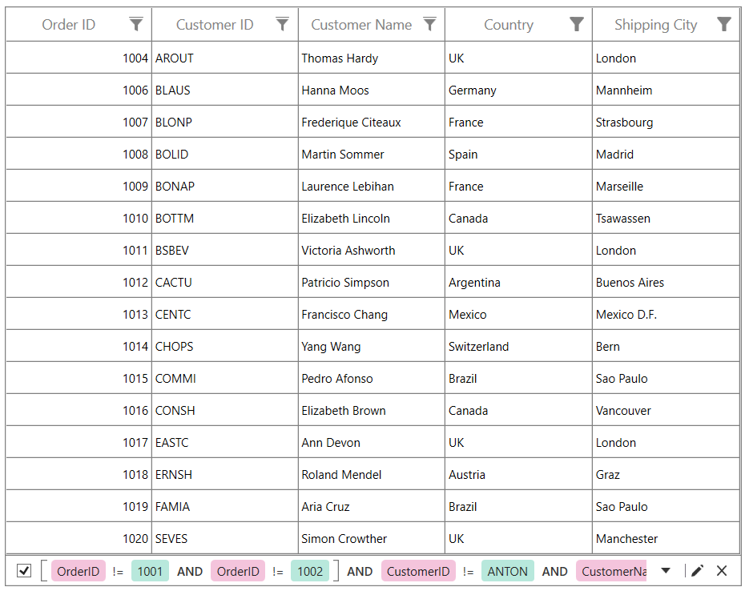
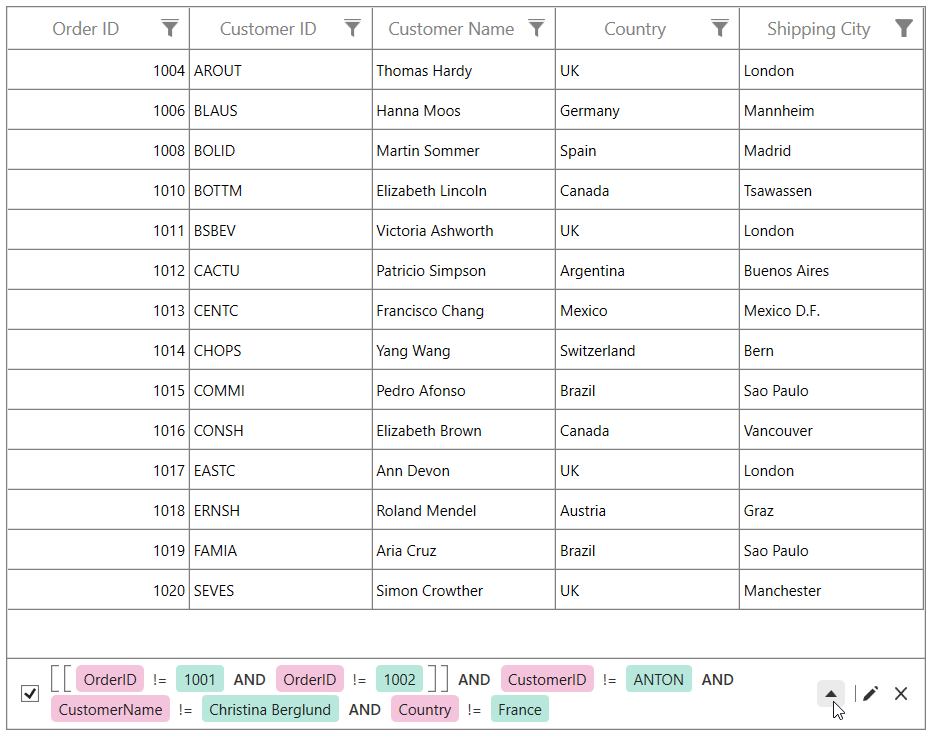

# Filter Editor in WPF Data Grid

[WPF Data Grid](https://www.syncfusion.com/wpf-controls/datagrid) allows you to create complex filter criteria by combining multiple conditions with logical operators and nested groups through the Filter Editor. The applied filter criteria can be displayed in the Filter Editor Panel, which stays synchronized with the supported filtering operations performed in the Grid.

Before enabling the Filter Editor, ensure filtering is enabled by setting [SfDataGrid.AllowFiltering](https://help.syncfusion.com/cr/wpf/Syncfusion.UI.Xaml.Grid.SfGridBase.html#Syncfusion_UI_Xaml_Grid_SfGridBase_AllowFiltering) to `true`.

## Enable Filter Editor

You can enable the Filter Editor by setting the [SfDataGrid.EnableFilterEditor](https://help.syncfusion.com/cr/wpf/Syncfusion.UI.Xaml.Grid.SfDataGrid.html#Syncfusion_UI_Xaml_Grid_SfDataGrid_EnableFilterEditor) property to `true`. The default value is `false`.

When `EnableFilterEditor` is set to `true`, the Filter Editor action is displayed in the column filter popup. The Edit Filter icon is also displayed in the Filter Editor Panel.



<syncfusion:SfDataGrid x:Name="dataGrid"
                       AllowFiltering="True"
                       AutoGenerateColumns="True"
                       EnableFilterEditor="True"
                       ItemsSource="{Binding Orders}" />


this.dataGrid.EnableFilterEditor = true;



N> The `EnableFilterEditor` property controls the availability of the Filter Editor actions in the column filter popup and Filter Editor Panel. It does not control the visibility or position of the Filter Editor Panel.

## Open Filter Editor

You can open the Filter Editor in the following ways:

* From the column filter popup.
* From the Filter Editor Panel.

### Open from the column filter popup

You can open the Filter Editor by clicking the filter icon in the column header and selecting the **Filter Editor** action from the column filter popup.

### Open from the Filter Editor Panel

You can click the **Edit Filter** icon in the Filter Editor Panel to open the Filter Editor and modify the current filter criteria. After applying the updated filter criteria, the Grid records and the filter expression displayed in the Filter Editor Panel are refreshed.

## Apply filter criteria

The Filter Editor allows you to create filter criteria by selecting a field, filter operator, and filter value. You can add multiple filter conditions and combine them using the `AND` or `OR` logical operator.

You can also organize the conditions into nested groups to create complex filter expressions.

The Filter Editor provides the following actions:

* **Apply** - Applies the current filter criteria to the Grid and keeps the Filter Editor open.
* **OK** - Applies the current filter criteria to the Grid and closes the Filter Editor.
* **Cancel** - Discards the pending changes and closes the Filter Editor.

After applying the filter criteria, the Grid displays the records that satisfy the filter expression. The applied filter expression is also displayed in the Filter Editor Panel when the panel position is set to `Top` or `Bottom`.

## Filter Editor Panel

The Filter Editor Panel displays the current filter criteria applied to the Grid and supports the following actions:

* Enable or suspend the applied filter.
* Expand or collapse the displayed expression.
* Open the Filter Editor to modify the filter criteria.
* Hide the panel without clearing the applied filter.

The panel is synchronized with the filtering changes performed through the supported Grid filtering options.

You can display the Filter Editor Panel by setting the [SfDataGrid.FilterPanelPosition](https://help.syncfusion.com/cr/wpf/Syncfusion.UI.Xaml.Grid.SfDataGrid.html#Syncfusion_UI_Xaml_Grid_SfDataGrid_FilterPanelPosition) property to `Top` or `Bottom`. The default value is `None`.

| Value     | Description                                                |
|-----------|------------------------------------------------------------|
| **Top**    | Displays the Filter Editor Panel above the records. |
| **Bottom** | Displays the Filter Editor Panel below the records. |
| **None**   | Hides the Filter Editor Panel.                             |



<syncfusion:SfDataGrid x:Name="dataGrid"
                       AllowFiltering="True"
                       AutoGenerateColumns="True"
                       EnableFilterEditor="True"
                       FilterPanelPosition="Bottom"
                       ItemsSource="{Binding Orders}" />


this.dataGrid.FilterPanelPosition = FilterPanelPosition.Bottom;



N> Setting `FilterPanelPosition` to `None` hides only the Filter Editor Panel. It does not clear or modify the filters applied to the Grid.

## Expand or collapse the filter expression

The Filter Editor Panel displays the filter expression in a compact single-line view by default.

When the complete expression cannot be displayed within the available width, the expand icon is displayed. You can click the expand icon to display the expression in multiple wrapped lines.

You can click the collapse icon to return the expression to the compact single-line view.

Expanding or collapsing the filter expression changes only its presentation and does not modify the applied filter.

## Enable or suspend filtering

You can use the **Enable Filter** CheckBox in the Filter Editor Panel to enable or suspend the applied filter criteria.

When the CheckBox is checked, the retained filter criteria are applied to the Grid. When the CheckBox is unchecked, filtering is suspended without removing the retained filter criteria.

When filtering is suspended by unchecking the CheckBox, you can reapply the retained filter criteria by checking the CheckBox again.

The CheckBox always reflects the current filtering state of the Grid.

## Close the Filter Editor Panel

You can click the Close icon in the Filter Editor Panel to hide the panel. Closing the panel changes only its visibility and does not clear or modify the filter criteria applied to the Grid.

When `FilterPanelPosition` is set to **Top** or **Bottom**, the panel becomes visible again after a filtering change.

When `FilterPanelPosition` is set to **None**, the panel remains hidden even after subsequent filtering changes.

Closing the Filter Editor Panel does not:

* Clear the filters applied to the Grid.
* Modify the retained filter criteria.
* Change the configured `FilterPanelPosition`.
* Disable filtering in the Grid.

## Filter synchronization

The Filter Editor and Filter Editor Panel are synchronized with the supported filtering operations in the Grid.

The filter criteria and panel state are updated when filtering is performed through:

* [Checkbox Filter UI](https://help.syncfusion.com/grid-sdk/wpf/data-grid/filtering#excel-like-ui-filtering).
* [Advanced Filter UI](https://help.syncfusion.com/grid-sdk/wpf/data-grid/filtering#advanced-filter-ui).
* [Filter Row](https://help.syncfusion.com/grid-sdk/wpf/data-grid/filterrow).
* [GridColumn Filter Predicates](https://help.syncfusion.com/grid-sdk/wpf/data-grid/filtering#column-filtering).
* [Filter Editor](https://help.syncfusion.com/grid-sdk/wpf/data-grid/filtereditor).

When the filtering state changes:

* The Grid displays the records that satisfy the updated filter.
* The Filter Editor Panel displays the updated filter expression.
* The Enable Filter CheckBox reflects the active filtering state.
* A manually closed panel becomes visible again when `FilterPanelPosition` is set to **Top** or **Bottom**.
* The panel remains hidden when `FilterPanelPosition` is set to **None**.

N> The `EnableFilterEditor` property does not control filter synchronization. It controls only the availability of the Filter Editor action in the column filter popup and the Edit Filter icon in the Filter Editor Panel.

## Styling

You can customize the appearance of the Filter Editor and the Filter Editor Panel by using the following `SfDataGrid` properties.

| Property | Type | Default | Target type |
|----------|------|---------|-------------|
| `FilterEditorStyle` | `Style` | `null` | `SfFilterEditor` |
| `FilterPanelStyle` | `Style` | `null` | `FilterEditorPanel` |

### Customize the Filter Editor

You can set the `SfDataGrid.FilterEditorStyle` property to customize the Filter Editor opened by the Grid. The style must target `SfFilterEditor`. The style is applied each time the Filter Editor is opened.

The `SfFilterEditor` control exposes the following brush properties.

| Property | Description |
|----------|-------------|
| `FieldForeground` | Foreground of the field selector. |
| `OperatorForeground` | Foreground of the operator selector. |
| `ValueForeground` | Foreground of the value editor. |
| `NodeBorderBrush` | Border brush of the condition and group nodes. |
| `ConnectorBrush` | Brush of the connector lines between nodes. |
| `ValidationBrush` | Brush used to indicate an invalid value. |

The `Background`, `Foreground`, `BorderBrush` and `BorderThickness` properties are also set by the default style.



<Window.Resources>
    
</Window.Resources>

<syncfusion:SfDataGrid x:Name="dataGrid"
                       AllowFiltering="True"
                       AutoGenerateColumns="True"
                       EnableFilterEditor="True"
                       FilterEditorStyle="{StaticResource customFilterEditorStyle}"
                       ItemsSource="{Binding Orders}" />


this.dataGrid.FilterEditorStyle = this.FindResource("customFilterEditorStyle") as Style;



N> Add the `xmlns:filtereditor="clr-namespace:Syncfusion.Data.FilterEditor;assembly=Syncfusion.Data.WPF"` namespace to the window. The `Syncfusion.Data.WPF` assembly is required.

### Customize the Filter Editor Panel

You can set the `SfDataGrid.FilterPanelStyle` property to customize the Filter Editor Panel without replacing the panel instance. The style is reapplied when the Grid template is reapplied. Setting the property to `null` restores the default style.

The `FilterEditorPanel` control exposes the following properties for the filter expression tokens.

| Property | Description |
|----------|-------------|
| `MemberBackground` | Background of the field name tokens. |
| `MemberForeground` | Foreground of the field name tokens. |
| `ValueBackground` | Background of the value tokens. |
| `ValueForeground` | Foreground of the value tokens. |



<Window.Resources>
    
</Window.Resources>

<syncfusion:SfDataGrid x:Name="dataGrid"
                       AllowFiltering="True"
                       AutoGenerateColumns="True"
                       EnableFilterEditor="True"
                       FilterPanelPosition="Bottom"
                       FilterPanelStyle="{StaticResource customFilterPanelStyle}"
                       ItemsSource="{Binding Orders}" />


this.dataGrid.FilterPanelStyle = this.FindResource("customFilterPanelStyle") as Style;



### Customize the Filter Editor Panel at runtime

You can access the Filter Editor Panel hosted by the DataGrid through the read-only `SfDataGrid.FilterPanel` property and customize its appearance at runtime.

The Filter Editor Panel instance is created and managed by the DataGrid and cannot be replaced. However, you can modify its public appearance properties after the panel is created.



private void UpdateFilterPanelAppearance()
{
    FilterEditorPanel panel = this.dataGrid.FilterPanel;

    if (panel == null)
        return;

    panel.Background = Brushes.GhostWhite;
    panel.Foreground = Brushes.DarkBlue;
    panel.BorderBrush = Brushes.RoyalBlue;
    panel.BorderThickness = new Thickness(1);
    panel.MemberBackground = Brushes.CornflowerBlue;
    panel.MemberForeground = Brushes.White;
    panel.ValueBackground = Brushes.LightSteelBlue;
    panel.ValueForeground = Brushes.DarkSlateGray;
}



Use the `FilterPanelStyle` property to apply a reusable predefined style. Use the `FilterPanel` property to customize individual appearance properties directly at runtime.

N> The `FilterPanel` property returns `null` when the Filter Editor Panel is unavailable, such as when `FilterPanelPosition` is set to `None` or before the DataGrid template creates the panel.

## Theme Support

The Filter Editor and Filter Editor Panel support the built-in Syncfusion themes. Refer to the below links to apply themes for the SfDataGrid,
* [Apply a theme to the Grid by using SfSkinManager](https://help.syncfusion.com/wpf/themes/skin-manager).
* [Create a custom theme using ThemeStudio](https://help.syncfusion.com/wpf/themes/theme-studio#creating-custom-theme)



<Window xmlns:syncfusion="http://schemas.syncfusion.com/wpf"
        xmlns:sfskin="clr-namespace:Syncfusion.SfSkinManager;assembly=Syncfusion.SfSkinManager.WPF"
        sfskin:SfSkinManager.Theme="{sfskin:SkinManager ThemeName=FluentDark}">
    <syncfusion:SfDataGrid x:Name="dataGrid"
                           AllowFiltering="True"
                           AutoGenerateColumns="True"
                           EnableFilterEditor="True"
                           FilterPanelPosition="Bottom"
                           ItemsSource="{Binding Orders}" />
</Window>


SfSkinManager.SetTheme(this, new Theme("FluentDark"));



N> The Filter Editor Panel uses the theme applied to the `SfDataGrid`. The Filter Editor window requires the current Grid theme to be applied separately because it is created as a separate window.

### Apply the theme to the Filter Editor window

The Filter Editor is hosted in a separate window. Hence, the theme applied to the `SfDataGrid` is not automatically applied to the Filter Editor window.

You can apply the current `SfDataGrid` theme to the Filter Editor window by handling the `FilterEditorWindow.Loaded` event and calling the `SfSkinManager.SetTheme` method.

The theme applied to the `SfDataGrid` can be retrieved by using the `SfSkinManager.GetTheme` method and applied to the Filter Editor window when it is loaded.




this.dataGrid.FilterEditorWindowLoaded += OnFilterEditorWindowLoaded ;

private void OnFilterEditorWindowLoaded(object sender, FilterEditorWindowEventArgs e)
{
    Theme currentTheme = SfSkinManager.GetTheme(this.dataGrid);
    if (currentTheme != null)
    {
        SfSkinManager.SetTheme(e.FilterEditorWindow, currentTheme);
    }
}




## Limitations

The following limitations apply to the Filter Editor integration:

* Filter criteria can be created only for the fields available through the [SfDataGrid.Columns](https://help.syncfusion.com/cr/wpf/Syncfusion.UI.Xaml.Grid.SfDataGrid.html#Syncfusion_UI_Xaml_Grid_SfDataGrid_Columns).
* Columns for which filtering is disabled are not available for creating filter conditions.
* Filters applied using the [SfDataGrid.View.Filter](https://help.syncfusion.com/cr/wpf/Syncfusion.Data.CollectionViewAdv.html#Syncfusion_Data_CollectionViewAdv_Filter) delegate are not displayed as editable filter expressions in the Filter Editor.